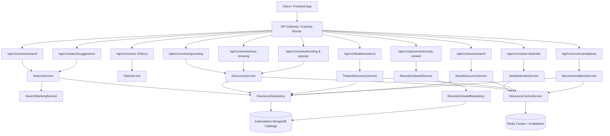

# 01 - Search & Movie Discovery System Architecture

## Executive Overview

The Discovery, Search, and Recommendation Engine for our corporate-level movie ticket booking platform provides low-latency ($< 35\text{ms}$), multi-dimensional exploration across movies, theatres, screens, and published shows. Built on a modular monolith MERN foundation with Redis distributed caching, the discovery subsystem unifies text search, faceted filtering, geospatial theatre radius discovery, explainable personalized recommendations, and real-time show availability checks.

---

## Architectural Principles

1. **Replaceable Search Provider Abstraction**:
   - The design decouples query construction from storage mechanics.
   - Built with MongoDB regex and native text search with safe regex escaping (`DiscoveryRepository.escapeRegex`), maintaining compatibility across community MongoDB, Atlas Search, and external engines (Elasticsearch/Typesense).

2. **Published Show Truth Verification**:
   - Movie statuses like `NOW_SHOWING` are descriptive, but true now-showing discovery is guaranteed only when published, uncancelled, bookable show records exist in the requested city and date window.

3. **Strict Catalog Visibility Firewall**:
   - Only movies with status $\in \{\text{APPROVED}, \text{UPCOMING}, \text{NOW\_SHOWING}\}$ and `isDeleted: false` can ever be discovered.
   - Draft, rejected, pending, or archived movies are prevented from leaking at the database query layer.

4. **Multi-Tiered Redis Cache & Invalidation**:
   - Search suggestions, trending velocity, popular rankings, and theatre lists are cached with designated TTLs (5 to 60 minutes).
   - Invalidation hooks trigger targeted invalidation upon movie updates, approvals, archiving, or show scheduling changes.

5. **Explainable Recommendations Without ML Overhead**:
   - Rule-based weighted scoring formula based on user booking history and recently viewed items.
   - Every recommended movie includes a human-readable explanation (`"Recommended because it matches your preferred genres (Gujarati Drama)"`).
