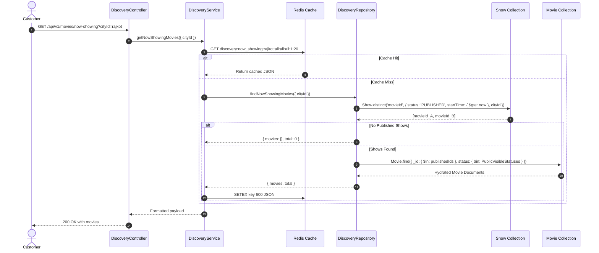

# 04 - Upcoming & Now Showing Movie Discovery

## 1. Upcoming Movies (`GET /api/v1/movies/upcoming`)

The upcoming discovery endpoint surfaces anticipated movies scheduled for future theatrical release:

- **Filter Criteria**:
  - `status: { $in: ['UPCOMING', 'APPROVED'] }`
  - `releaseDate: { $gt: now }`
  - `isDeleted: false`
- **Default Sort**: `releaseDate: 1` (soonest releases first)
- **Supported Query Filters**: `genre`, `language`, `page`, `limit`
- **Redis Cache Key**: `discovery:upcoming:<genre>:<lang>:<page>:<limit>` (TTL: 30 minutes)

---

## 2. Now Showing Movies (`GET /api/v1/movies/now-showing`)

### Published Show Truth Verification

Unlike static catalog filters, **Now Showing** discovery strictly adheres to published show records as the single source of truth. A movie marked with `status: 'NOW_SHOWING'` will **NOT** appear in `/api/v1/movies/now-showing` unless it has active, published, and bookable shows.

### City & Date Scoping

When `cityId` or `date` is passed:
1. `Show` records are filtered by `cityId` and `startTime` spanning the calendar day.
2. Only movie IDs exhibiting in that city and date window are retrieved.
3. If no published shows exist in that city, an empty list `{ movies: [], total: 0 }` is returned, preventing consumers from attempting to book unavailable movies.
