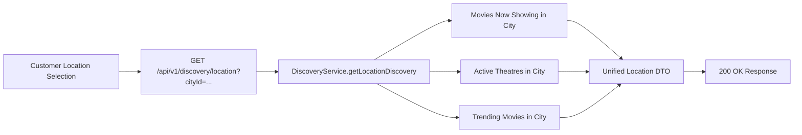

# 08 - Location-Based Discovery Landing Engine

## Endpoint Specification

- **HTTP Method**: `GET`
- **Route**: `/api/v1/discovery/location`
- **Access Control**: Public

---

## Architectural Context

When a customer navigates to the platform or selects their current location (e.g., Rajkot, Mumbai, Ahmedabad), the platform aggregates a regional discovery package in a single round-trip:



---

## Unified Payload Structure

```json
{
  "success": true,
  "message": "Location discovery retrieved successfully",
  "data": {
    "city": {
      "_id": "65f1a2b3c4d5e6f7a8b9c099",
      "name": "Rajkot",
      "state": "Gujarat",
      "slug": "rajkot"
    },
    "nowShowing": [
      {
        "_id": "65f1a2b3c4d5e6f7a8b9c0aa",
        "title": "Chhello Show",
        "slug": "chhello-show",
        "posterUrl": "https://cdn.example.com/chhello.jpg",
        "avgRating": 8.9
      }
    ],
    "theatres": [
      {
        "_id": "65f1a2b3c4d5e6f7a8b9c011",
        "name": "Cosmoplex Cinema",
        "address": {
          "cityName": "Rajkot",
          "area": "Kalawad Road",
          "pincode": "360005"
        },
        "amenities": ["DOLBY_ATMOS", "PARKING"]
      }
    ],
    "trending": [
      {
        "_id": "65f1a2b3c4d5e6f7a8b9c0aa",
        "title": "Chhello Show",
        "trendingVelocity": 45
      }
    ]
  }
}
```
