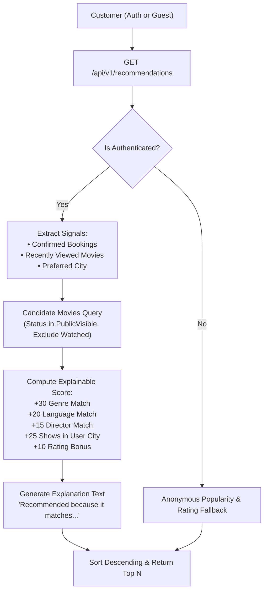

# 09 - Rule-Based Explainable Recommendation Engine

## Architecture & Scoring Formula

The platform employs a deterministic, rule-based recommendation engine that delivers personalized, explainable suggestions without introducing machine learning operational overhead.

---

## Scoring Formula Breakdown

For any candidate public movie $m$ and user profile $u$:

$$\text{Score}(m, u) = S_{\text{genre}} + S_{\text{lang}} + S_{\text{director}} + S_{\text{shows}} + S_{\text{rating}}$$

| Signal Component | Points | Description |
|---|---|---|
| $S_{\text{genre}}$ | $+30$ | Movie shares top genres from user's confirmed booking history |
| $S_{\text{lang}}$ | $+20$ | Movie is presented in user's most frequently booked languages |
| $S_{\text{director}}$ | $+15$ | Movie is directed by a filmmaker the user previously booked |
| $S_{\text{shows}}$ | $+25$ | Movie has active published shows in the user's selected/home city |
| $S_{\text{rating}}$ | $+0$ to $+10$ | Movie critic & audience rating factor: $\frac{\text{avgRating}}{10} \times 10$ |

---

## Explainability Contract

Every recommendation returned to the client contains a clear, natural-language explanation string. Examples:

- `"Recommended because it matches your preferred genres (Action, Sci-Fi) and currently showing in theatres near you"`
- `"Recommended because it was directed by a filmmaker you enjoyed"`
- `"Recommended based on high viewer ratings"` (Anonymous / Guest fallback)
