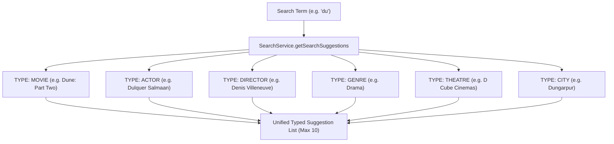

# 12 - Real-Time Search Suggestions & Autocomplete

## Endpoint Specification

- **HTTP Method**: `GET`
- **Route**: `/api/v1/search/suggestions?q=`
- **Access Control**: Public
- **Target Latency**: $< 25\text{ms}$ (via Redis caching)
- **Cache TTL**: 15 minutes (`900s`)

---

## Suggestion Taxonomy

The autocomplete engine queries multiple discovery entities and returns typed suggestion objects so client frontends can render appropriate icons and route to dedicated detail pages:



---

## Sample Response

```json
{
  "success": true,
  "message": "Search suggestions retrieved successfully",
  "data": [
    {
      "type": "MOVIE",
      "title": "Dune: Part Two",
      "slug": "dune-part-two",
      "posterUrl": "https://cdn.example.com/dune2.jpg",
      "censorRating": "UA",
      "year": 2026
    },
    {
      "type": "GENRE",
      "title": "Drama",
      "slug": "drama"
    },
    {
      "type": "THEATRE",
      "title": "D Cube Cinemas",
      "slug": "d-cube-cinemas",
      "city": "Rajkot",
      "area": "150ft Ring Road"
    }
  ],
  "meta": {
    "count": 3
  }
}
```
