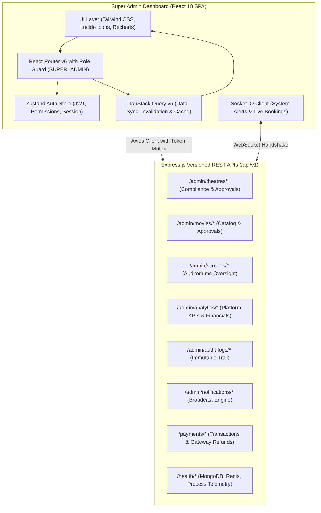

# 02 – Super Admin Frontend Architecture

## 1. Architectural Philosophy
The Super Admin Dashboard (`apps/admin-dashboard`) is an enterprise-grade Single Page Application (SPA) designed for platform executives, compliance officers, and operations engineers overseeing the entire multi-tenant cinema ecosystem.



---

## 2. Directory Layout & Module Structure
```
apps/admin-dashboard/
├── src/
│   ├── components/
│   │   ├── layout/       # AdminLayout, Sidebar, Header, Breadcrumbs, ProtectedRoute
│   │   ├── ui/           # Button, Input, Select, DataTable, StatCard, StatusBadge, Modal, ConfirmDialog
│   │   └── charts/       # RevenueTrendChart, BookingVelocityChart, StatusDonutChart, TopListChart
│   ├── features/
│   │   ├── auth/         # LoginPage (strict SUPER_ADMIN verification)
│   │   ├── overview/     # Master Executive Dashboard, KPIs, charts, quick actions
│   │   ├── users/        # User Explorer & Account Audit
│   │   ├── theatre-owners/# Theatre Owners Directory & Partner Verification
│   │   ├── approvals/    # Theatre Compliance Approval Workflow
│   │   ├── theatres/     # Theatres & Branches Oversight
│   │   ├── movies/       # Movie Catalog Management & Content Approvals
│   │   ├── screens/      # Screens & Layout Inspection
│   │   ├── shows/        # Show Scheduling Oversight & Emergency Cancellation
│   │   ├── bookings/     # Platform Booking Explorer & Ticket Admissions
│   │   ├── payments/     # Payment Transactions & Razorpay Gateway Refunds
│   │   ├── commissions/  # Platform Commission Settings & Audit
│   │   ├── settlements/  # Theatre Financial Settlements Ledger & CSV Export
│   │   ├── coupons/      # Promotional Campaign Governance
│   │   ├── notifications/# Broadcast Announcement Dispatcher & Delivery Stats
│   │   ├── analytics/    # Deep-dive Analytics Reports (Bookings, Revenue, Movies, Theatres)
│   │   ├── audit-logs/   # Immutable Append-Only Audit Log Viewer
│   │   ├── settings/     # Platform Settings & Security Policies
│   │   ├── health/       # System Health, MongoDB, Redis, and Process Telemetry
│   │   └── common/       # 404 NotFound & 403 AccessRestricted
│   ├── services/
│   │   ├── api/          # Axios HTTP Client & domain API services
│   │   └── socket/       # Socket.IO connection singleton
│   ├── store/            # auth.store.js
│   ├── utils/            # formatters, cn, csvExport
│   ├── tests/            # Vitest unit and integration test suites
│   ├── App.jsx           # Master route registry
│   └── main.jsx          # Root initialization & QueryClientProvider
```

