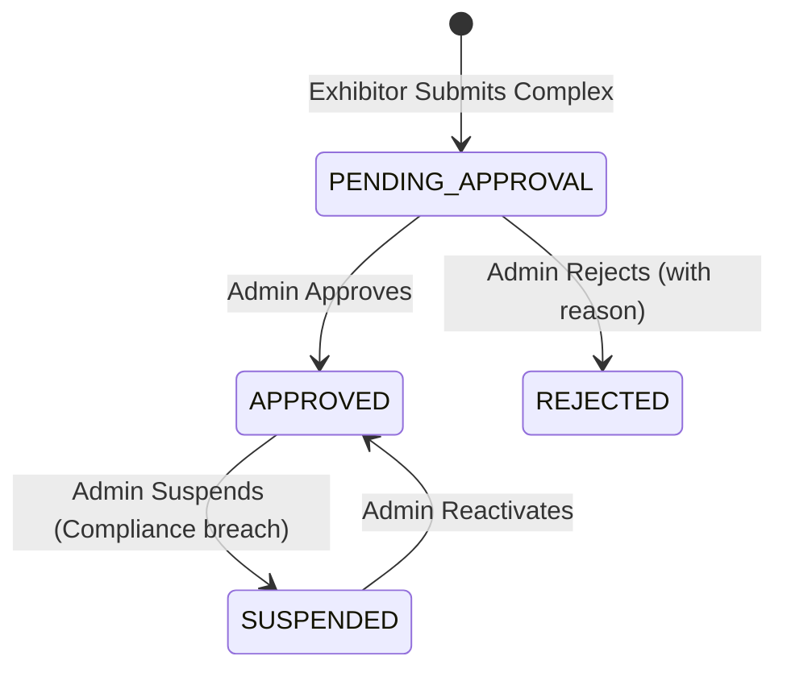

# 09 – Theatre Compliance and Approval Workflow

## 1. Onboarding Approval Lifecycle
When an exhibitor submits a new theatre complex, it enters the `PENDING_APPROVAL` queue.

---

## 2. API Endpoints
- `GET /api/v1/admin/theatres?status=PENDING_APPROVAL`: Queries pending applications.
- `PATCH /api/v1/admin/theatres/:id/approve`: Transitions state to `APPROVED`.
- `PATCH /api/v1/admin/theatres/:id/reject`: Transitions to `REJECTED` requiring mandatory reason `{ reason: string }`.
- `PATCH /api/v1/admin/theatres/:id/suspend`: Suspends active cinema complex.
- `PATCH /api/v1/admin/theatres/:id/reactivate`: Restores operational privileges.

