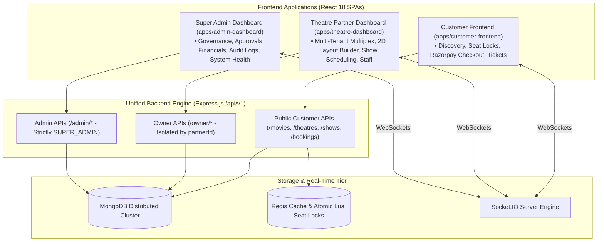

# 27 – Three-Application Integration Review

## 1. Multi-Application Ecosystem Overview
The BookMyShow-like platform encompasses three distinct frontend applications interacting with the unified backend API:

---

## 2. Cross-Application Contract Consistency Verification

| Verification Criterion | Customer Frontend | Theatre Partner Dashboard | Super Admin Dashboard | Consistency Status |
|---|---|---|---|:---:|
| **Authentication Flow** | Dual-token JWT (`/auth/login`) | Dual-token JWT (`/auth/login`) | Dual-token JWT (`/auth/login`) | **100% Consistent** |
| **RBAC Enforcement** | `CUSTOMER` role check | `THEATRE_OWNER`, `MANAGER`, `STAFF` | Strict `SUPER_ADMIN` check | **100% Enforced** |
| **Movie Lifecycle** | Shows `RELEASED` & approved | Schedules `APPROVED` titles | Approves / Rejects titles | **100% Aligned** |
| **Theatre Onboarding** | Only displays `APPROVED` theatres | Registers & edits properties | Approves / Rejects / Suspends | **100% Aligned** |
| **Seat Inventory** | Atomic locks & real-time socket sync | 2D Layout Builder & live occupancy | Screen & layout oversight | **100% Aligned** |
| **Booking & Payments** | Razorpay modal payment & HMAC verify | Tenant-isolated booking explorer | Platform-wide explorer & refunds | **100% Aligned** |
| **Settlement Metrics** | Customer ticket total | Net payable (Gross - Fee - Refunds) | Platform commission (10%) & ledger | **100% Aligned** |

