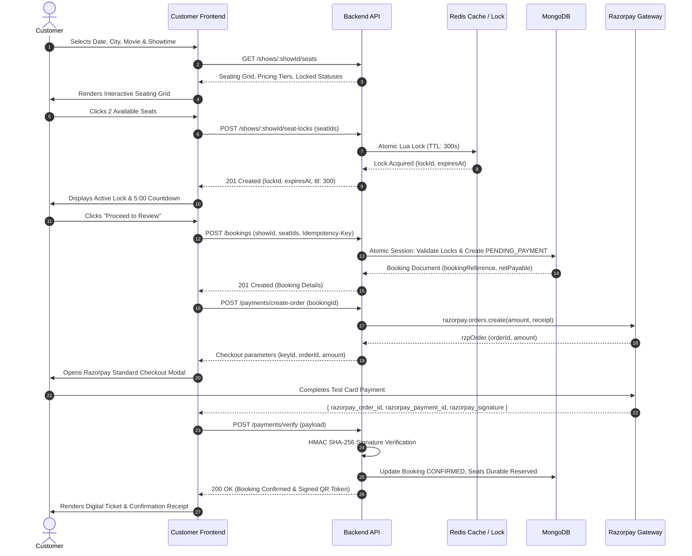

# Frontend Integration Audit & API Blueprint
**Part 15: Customer Frontend Development (React)**
**Document Reference: `docs/frontend-customer/01-frontend-integration-audit.md`**
**Status: APPROVED & VERIFIED AGAINST BACKEND PARTS 1–14**

---

## 1. Executive Summary

This document presents the complete integration audit between the existing production-grade BookMyShow backend (Node.js, Express, MongoDB, Redis, Socket.IO, Razorpay) and the newly initialized customer-facing React single-page application (`apps/customer-frontend`).

The inspection validates all active route prefixes, controller parameters, authentication mechanisms, real-time Socket.IO room lifecycle hooks, idempotency guarantees, and data contracts to ensure that frontend components never rely on mock data, client-authoritative pricing, or unverified payment states.

---

## 2. Authentication Strategy & Session Handling

### 2.1 Token Strategy
The platform implements a **Dual-Token Rotation Strategy**:
1. **Access Token (Short-Lived: 15 minutes)**: Signed JWT (`HS256`) containing `{ sub: userId, role, email, partnerId }`. Transmitted via `Authorization: Bearer <token>` in HTTP headers or stored securely in memory.
2. **Refresh Token (Long-Lived: 7 days)**: Opaque cryptographically random token stored in Redis session index with automatic rotation and family reuse detection. Transmitted primarily via **HttpOnly, Secure, SameSite=Strict** cookie (`res.cookie('refreshToken', ...)`), with fallback body representation for non-browser clients.

### 2.2 Token Refresh Flow
- When any protected API request encounters an HTTP `401 Unauthorized` with `TOKEN_EXPIRED`, the centralized Axios interceptor intercepts the failure.
- A single atomic call is queued to `POST /api/v1/auth/refresh` (with `withCredentials: true`).
- A mutex/promise queue in the Axios client prevents duplicate refresh calls when concurrent requests fail simultaneously.
- If refresh succeeds, the new access token is stored and queued requests are replayed.
- If refresh fails, session state is cleared and the customer is redirected to `/login` preserving `location.pathname` in `state.from`.

---

## 3. Standard API Envelopes & Error Normalization

### 3.1 Standard Success Envelope
All backend endpoints respond with the unified `ApiResponse` format:
```json
{
  "success": true,
  "message": "Operation completed successfully",
  "data": { ... },
  "meta": {
    "totalRecords": 100,
    "currentPage": 1,
    "pageSize": 10,
    "totalPages": 10,
    "hasNextPage": true,
    "hasPrevPage": false
  }
}
```

### 3.2 Standard Error Envelope
Error responses always adhere to:
```json
{
  "success": false,
  "message": "One or more seats have already been locked by another customer",
  "errorCode": "SEAT_ALREADY_LOCKED",
  "error": {
    "code": "SEAT_ALREADY_LOCKED",
    "details": ["65f1a2b3c4d5e6f7a8b9c0f3"]
  },
  "requestId": "req-987654321"
}
```

---

## 4. Comprehensive Backend API Directory

### 4.1 Authentication & Profile (`/api/v1/auth` & `/api/v1/users`)
| Method | Route | Description | Auth Required |
|---|---|---|---|
| `POST` | `/api/v1/auth/register` | Register customer account | No |
| `POST` | `/api/v1/auth/login` | Email/Phone + Password login | No |
| `POST` | `/api/v1/auth/refresh` | Refresh access token via cookie | No (Cookie) |
| `POST` | `/api/v1/auth/logout` | Terminate session & revoke token | Yes |
| `POST` | `/api/v1/auth/otp/send` | Send SMS/Email OTP | No |
| `POST` | `/api/v1/auth/otp/verify` | Verify OTP for auth/action | No |
| `POST` | `/api/v1/auth/password/forgot` | Request password reset token | No |
| `POST` | `/api/v1/auth/password/reset` | Set new password with token | No |
| `POST` | `/api/v1/auth/password/change` | Change password for logged user | Yes |
| `GET` | `/api/v1/users/me` | Current user profile | Yes |
| `PATCH` | `/api/v1/users/me` | Update name, phone, preferences | Yes |
| `GET` | `/api/v1/users/me/sessions` | List active user sessions | Yes |
| `DELETE`| `/api/v1/users/me/sessions/:id` | Revoke a specific session | Yes |

### 4.2 Discovery & Taxonomic Data (`/api/v1/movies`, `/api/v1/genres`, `/api/v1/languages`, `/api/v1/search`)
| Method | Route | Description | Auth Required |
|---|---|---|---|
| `GET` | `/api/v1/movies` | Filtered movies (page, limit, genre, language, status) | No |
| `GET` | `/api/v1/movies/:slug` | Movie details by URL slug | No |
| `GET` | `/api/v1/movies/now-showing` | Now-showing catalog | No |
| `GET` | `/api/v1/movies/upcoming` | Upcoming catalog | No |
| `GET` | `/api/v1/movies/trending` | Top trending movies | No |
| `GET` | `/api/v1/movies/popular` | Top popular movies | No |
| `GET` | `/api/v1/movies/:id/similar` | Similar movies based on genre/tags | No |
| `GET` | `/api/v1/genres` | Active movie genres | No |
| `GET` | `/api/v1/languages` | Supported movie languages | No |
| `GET` | `/api/v1/search/suggestions` | Debounced search suggestions (`?q=...`) | No |
| `GET` | `/api/v1/recommendations` | Personalized recommendation feed | Optional |
| `GET` | `/api/v1/discovery/location` | Geolocation-assisted city/theatre discovery | No |
| `GET` | `/api/v1/users/me/recently-viewed` | Customer's recently viewed movies | Yes |
| `POST` | `/api/v1/users/me/recently-viewed/:movieId` | Record movie impression | Yes |

### 4.3 Theatres, Cities & Showtimes (`/api/v1/theatres`, `/api/v1/cities`, `/api/v1/shows`)
| Method | Route | Description | Auth Required |
|---|---|---|---|
| `GET` | `/api/v1/cities` | List active cinema cities | No |
| `GET` | `/api/v1/theatres` | List active approved theatres (filter by city, query) | No |
| `GET` | `/api/v1/theatres/id/:theatreId` | Theatre details by ID | No |
| `GET` | `/api/v1/theatres/:slug` | Theatre details by URL slug | No |
| `GET` | `/api/v1/theatres/search` | Search theatres by name or area | No |
| `GET` | `/api/v1/shows` | Search shows (`cityId`, `movieId`, `theatreId`, `date`) | No |
| `GET` | `/api/v1/shows/:showId` | Single show detail | No |
| `GET` | `/api/v1/movies/:movieId/shows` | Showtimes for a movie in a city | No |
| `GET` | `/api/v1/theatres/:theatreId/shows` | Showtimes at a theatre for a date | No |

### 4.4 Real-Time Seat Availability & Locks (`/api/v1/shows`)
| Method | Route | Description | Auth Required |
|---|---|---|---|
| `GET` | `/api/v1/shows/:showId/seats` | Full screen seat layout + real-time status & pricing | Optional |
| `POST` | `/api/v1/shows/:showId/seat-locks` | Atomically lock 1–10 seats in Redis | Yes |
| `DELETE`| `/api/v1/shows/:showId/seat-locks` | Atomically release active locks | Yes |
| `PATCH` | `/api/v1/shows/:showId/seat-locks/renew` | Extend lock TTL if under renewal limit | Yes |

### 4.5 Booking Engine (`/api/v1/bookings`)
| Method | Route | Description | Auth Required |
|---|---|---|---|
| `POST` | `/api/v1/bookings` | Create pending booking from active locks (`Idempotency-Key`) | Yes |
| `GET` | `/api/v1/bookings/me` | Authenticated customer's booking history | Yes |
| `GET` | `/api/v1/bookings/:bookingId` | Comprehensive booking record, status, QR ticket | Yes |
| `POST` | `/api/v1/bookings/:bookingId/cancel` | Cancel booking within cutoff window | Yes |
| `GET` | `/api/v1/bookings/:bookingId/payments` | Payment transactions associated with booking | Yes |

### 4.6 Payment Gateway (`/api/v1/payments`)
| Method | Route | Description | Auth Required |
|---|---|---|---|
| `POST` | `/api/v1/payments/create-order` | Request Razorpay order for pending booking | Yes |
| `POST` | `/api/v1/payments/verify` | Submit checkout signature for HMAC verification | Yes |
| `GET` | `/api/v1/payments/:paymentId` | Transaction status & reconciliation detail | Yes |

### 4.7 Notification Center (`/api/v1/notifications`)
| Method | Route | Description | Auth Required |
|---|---|---|---|
| `GET` | `/api/v1/notifications` | Paginated in-app notifications | Yes |
| `GET` | `/api/v1/notifications/unread-count` | Unread notifications badge count | Yes |
| `PATCH` | `/api/v1/notifications/:id/read` | Mark single notification as read | Yes |
| `PATCH` | `/api/v1/notifications/read-all` | Mark all notifications as read | Yes |
| `DELETE`| `/api/v1/notifications/:id` | Dismiss in-app notification | Yes |
| `GET` | `/api/v1/notifications/preferences` | Channel preferences (Email, SMS, WhatsApp) | Yes |
| `PATCH` | `/api/v1/notifications/preferences` | Update customer notification preferences | Yes |

---

## 5. Real-Time Socket.IO Integration Specifications

The backend Socket.IO server operates on port 5000 (`/socket.io/`).

### 5.1 Authentication Handshake
Clients authenticate during handshake:
```js
const socket = io(SOCKET_URL, {
  auth: { token: accessToken },
  withCredentials: true,
  transports: ['websocket', 'polling']
});
```
- Authenticated sockets are automatically joined to `user:<userId>`.
- Unauthenticated sockets are granted `GUEST` status (can still subscribe to show seat rooms).

### 5.2 Room Lifecycle & Events
| Event | Direction | Payload | Usage |
|---|---|---|---|
| `show:join` | Client $\rightarrow$ Server | `{ showId }` | Emitted when entering Seat Selection view |
| `show:leave` | Client $\rightarrow$ Server | `{ showId }` | Emitted on component unmount / navigate away |
| `seat:locked` | Server $\rightarrow$ Room | `{ showId, seatIds, lockedAt }` | Marks seats as `LOCKED_BY_OTHER` in grid |
| `seat:released` | Server $\rightarrow$ Room | `{ showId, seatIds }` | Returns seats to `AVAILABLE` status |
| `seat:expired` | Server $\rightarrow$ Room | `{ showId, seatIds }` | Redis TTL expired; releases seats |
| `seat:booked` | Server $\rightarrow$ Room | `{ showId, seatIds }` | Booking confirmed; marks seats `BOOKED` |
| `show:availability-updated` | Server $\rightarrow$ Room | `{ reason }` | Signals client to invalidate seat layout cache |
| `notification:new` | Server $\rightarrow$ `user:<userId>` | `{ notification }` | Real-time in-app toast and badge increment |
| `booking:confirmed` | Server $\rightarrow$ `user:<userId>` | `{ bookingId, pnr }` | Out-of-band confirmation event |

---

## 6. End-to-End Business Flow Invariants



---

## 7. Integration Risks & Mitigations

1. **Stale Seat Availability**:
   - *Risk*: Patrons viewing a show while seats are locked by others might see outdated availability.
   - *Mitigation*: Socket.IO room listeners mutate local query state immediately; query invalidation triggers an authoritative background refetch on reconnect or window focus.
2. **Idempotency on Payment & Booking**:
   - *Risk*: Double submission if the user double-clicks "Proceed to Payment" or refreshes mid-flight.
   - *Mitigation*: Client generates a persistent UUID v4 idempotency token per seat selection session, attached in both HTTP headers and request bodies.
3. **Clock Skew in Countdown Timers**:
   - *Risk*: Client local machine clock may differ from the server timestamp, skewing the lock timer.
   - *Mitigation*: Expiration countdown is computed strictly from server-provided `ttlSeconds` and server `expiresAt` delta, not raw client `Date.now()`.
4. **Third-Party Razorpay Script Failure**:
   - *Risk*: Ad blockers or network latency blocking `checkout.razorpay.com/v1/checkout.js`.
   - *Mitigation*: Built-in asynchronous script loader utility with retry mechanism and user-friendly fallback messaging.

---

## 8. Verification & Audit Approval

- **All Required Backend Endpoints Present**: YES (Parts 1–14 provide 100% of required endpoints).
- **No Inventions or Workarounds Required**: YES (All requests adhere strictly to verified backend routes).
- **Audit Sign-off**: Senior React Architect & Principal Backend Engineer.

