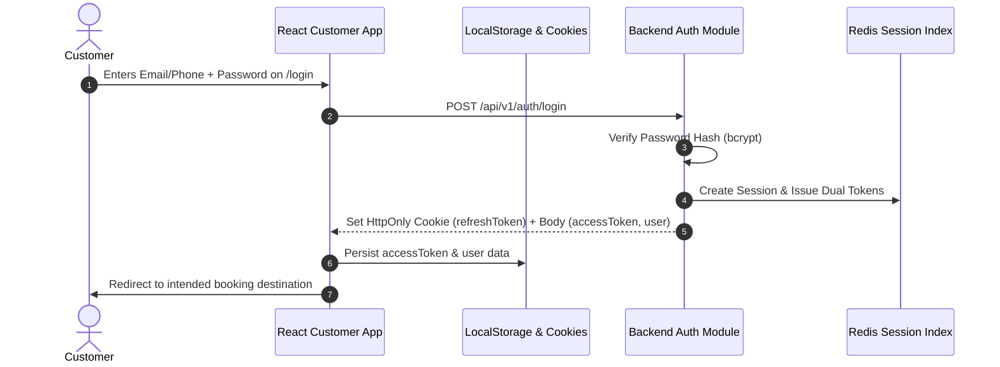

# Authentication Flow, Session Handling & Security
**Part 15: Customer Frontend Development (React)**
**Document Reference: `docs/frontend-customer/06-authentication-flow.md`**

---

## 1. Authentication Lifecycle

---

## 2. Session Hydration on Application Boot

On app mount in `RootLayout`:
1. `useAuthStore.getState().initAuth()` reads `bms_access_token`.
2. If token exists, calls `GET /api/v1/users/me` to verify user status, roles, and profile integrity.
3. Synchronizes real-time socket authentication via `socketService.updateAuth(accessToken)`.
4. If token is expired, triggers `POST /api/v1/auth/refresh` silently.

---

## 3. Logout & Invalidation

When user clicks "Sign Out":
1. Calls `authApi.logout()` (`POST /api/v1/auth/logout`) which revokes the active Redis session and deletes the HttpOnly `refreshToken` cookie.
2. Clears client `localStorage` keys (`bms_access_token`, `bms_user_data`).
3. Resets `useAuthStore` state.
4. Cleans up Socket.IO private user channels.
5. Redirects to `/`.

