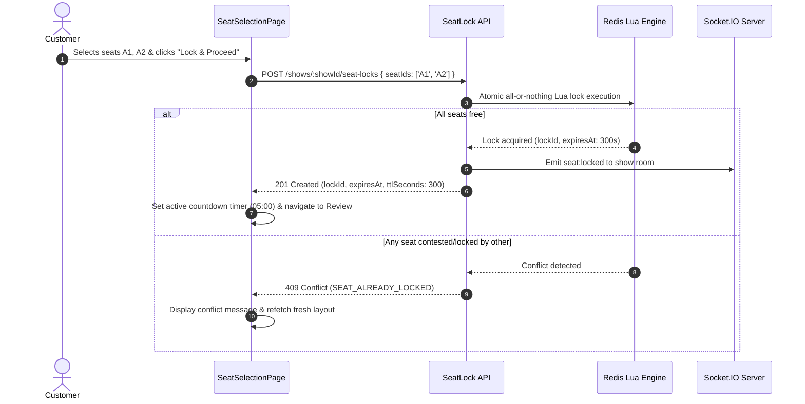

# Interactive Seat Selection & Real-Time Locking
**Part 15: Customer Frontend Development (React)**
**Document Reference: `docs/frontend-customer/09-seat-selection-and-locking.md`**

---

## 1. Seating Layout Renderer

The interactive seat selector (`src/components/seat/SeatingLayoutGrid.jsx`) renders a published cinema layout without hardcoded seat arrangements:
- **Curved Screen Indicator**: SVG arc visualizes the screen position at the top of the hall.
- **Category Tier Grouping**: Rows are grouped by pricing categories (e.g. Platinum, Gold, Silver), displaying tier headers with per-seat prices.
- **Physical Rows & Aisles**: Displays row letters (`A`, `B`, `C`), seat numbers (`1`, `2`, `3`), and aisle gaps based on screen coordinates.
- **Selection Ceiling**: Limits seat selections to a maximum of 10 seats per transaction.

---

## 2. Distributed Atomic Seat Locking (Part 9 Integration)

---

## 3. Real-Time Socket.IO Synchronization

The `useShowSeatsSocket(showId)` hook subscribes to the show room:
- `seat:locked`: Another patron locked seats; updates their status to `LOCKED_BY_OTHER`.
- `seat:released`: Locks released; seats become `AVAILABLE`.
- `seat:expired`: Redis TTL expired; releases seats.
- `seat:booked`: Permanent booking confirmed; seats turn `BOOKED`.
- `show:availability-updated`: Signals client to invalidate TanStack Query cache.

