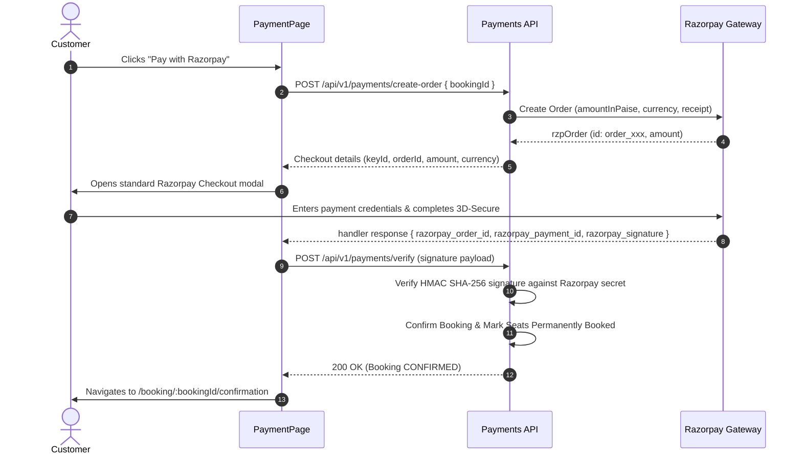

# Razorpay Gateway Checkout & Signature Verification
**Part 15: Customer Frontend Development (React)**
**Document Reference: `docs/frontend-customer/11-payment-integration.md`**

---

## 1. Razorpay Integration Lifecycle

---

## 2. Zero-Trust Security Invariants

1. **No Gateway Secrets in Bundle**: The client never stores or knows the `RAZORPAY_KEY_SECRET`. Only the public `keyId` returned from the backend order endpoint is used to mount the checkout script.
2. **Never Trust Client Confirmation**: The frontend never marks a booking confirmed on its own. Confirmation requires cryptographic HMAC SHA-256 verification by the backend or an authoritative webhook callback.
3. **Handling Modal Dismissal**: If the patron closes the checkout modal (`modal.ondismiss`), the booking remains in `PENDING_PAYMENT` until the seat lock TTL expires, allowing the patron to retry payment.

