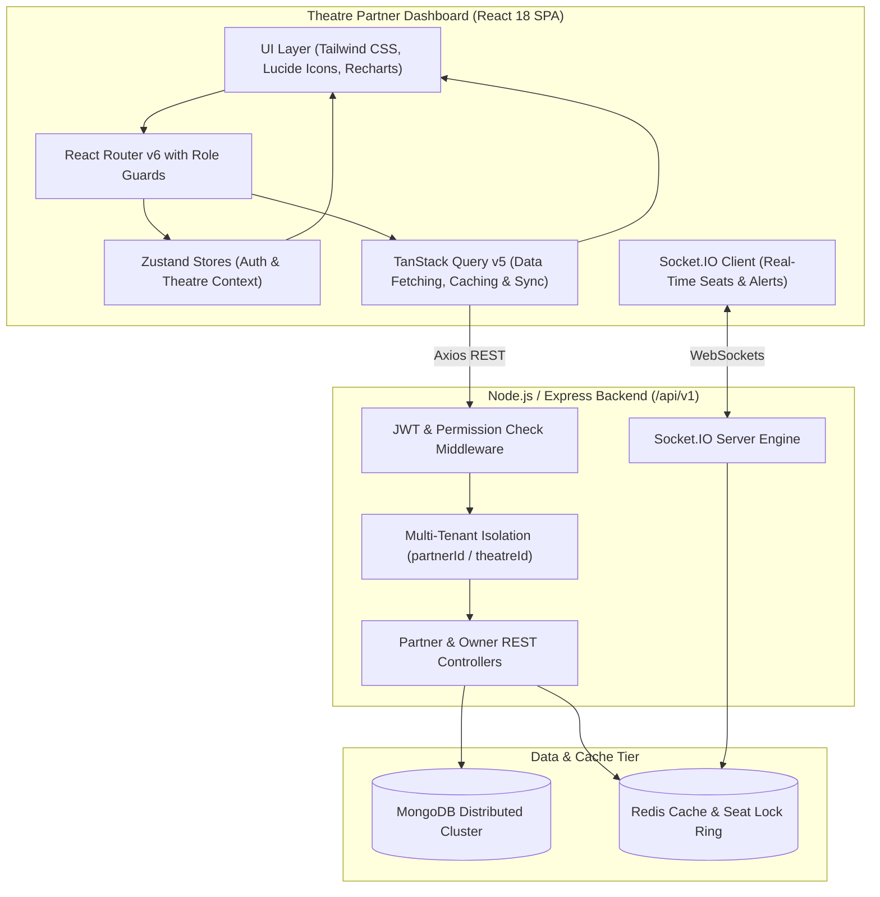

# 02 – Theatre Dashboard Architecture

## 1. High-Level Architectural Overview
The **Theatre Partner Dashboard** is an enterprise-grade Single Page Application (SPA) designed to empower cinema operators, theatre owners, multiplex managers, and box-office operations personnel to administer screens, layouts, shows, seat inventories, ticket admissions, and financial settlements.



---

## 2. Core Architecture Principles

### 2.1 Strict Tenant Isolation (Zero Data Leakage)
Every API query is automatically contextualized by the authenticated partner's identity (`req.user.partnerId`). The frontend maintains a `theatreContext.store` allowing partners owning multiple multiplexes to switch between theatres while preventing any cross-tenant data visibility.

### 2.2 Granular RBAC Permissiveness Matrix
- **THEATRE_OWNER**: Unrestricted administrative authority over partner organization, pricing, screens, staff, and financial settlements.
- **THEATRE_MANAGER**: Daily operations authority (show scheduling, pricing adjustments, screen status toggles, staff oversight).
- **THEATRE_STAFF**: Operational floor access (booking lookup, ticket validation, seating occupancy monitoring).

### 2.3 Resilient Network Layer with Dual-Token Refresh
All HTTP communication passes through a unified Axios client (`axios.client.js`). If an access token expires during an operation, the client queues concurrent failed requests, invokes `/auth/refresh` using the secure HttpOnly cookie, and seamlessly replays the queued requests without user interruption.

### 2.4 Real-Time Synchronization via WebSockets
Live updates for real-time ticket sales and seat locks are subscribed to on demand using scoped room subscriptions (`partner:<id>` and `show:<id>`).

---

## 3. Directory Layout Standards
```
apps/theatre-dashboard/
├── src/
│   ├── assets/
│   ├── components/
│   │   ├── layout/       # DashboardLayout, Sidebar, Header, Breadcrumbs
│   │   ├── ui/           # Button, Input, Modal, DataTable, StatCard, Badge
│   │   └── charts/       # RevenueChart, BookingTrendChart, OccupancyChart
│   ├── features/
│   │   ├── auth/         # Login, Register, Forgot Password
│   │   ├── overview/     # Partner Overview, Metrics Cards, Recent Activity
│   │   ├── theatres/     # Theatres, Branches, Screen listings
│   │   ├── layout-builder/ # 2D Interactive Seat Layout Editor
│   │   ├── movies/       # Approved Movie Catalog for Scheduling
│   │   ├── shows/        # Show Scheduler, Conflict Detector, Calendar
│   │   ├── pricing/      # Category-wise Dynamic Pricing
│   │   ├── bookings/     # Booking Explorer, Admissions, QR Scanner
│   │   ├── revenue/      # Settlement Statements, CSV Downloads
│   │   ├── staff/        # Staff Invitations, Role Management
│   │   ├── operations/   # Live Screen Monitoring
│   │   ├── notifications/# Alerts, WebSocket event toasts
│   │   └── settings/     # Profile, Facilities, Operating Rules
│   ├── services/
│   │   ├── api/          # Axios client & domain API endpoints
│   │   └── socket/       # Socket.IO client singleton
│   ├── store/            # auth.store, theatreContext.store
│   ├── utils/            # formatters, validators, csvExport
│   ├── tests/            # Vitest unit and integration suites
│   ├── App.jsx           # Master route configuration
│   └── main.jsx          # Root mounting and React Query Provider
```

