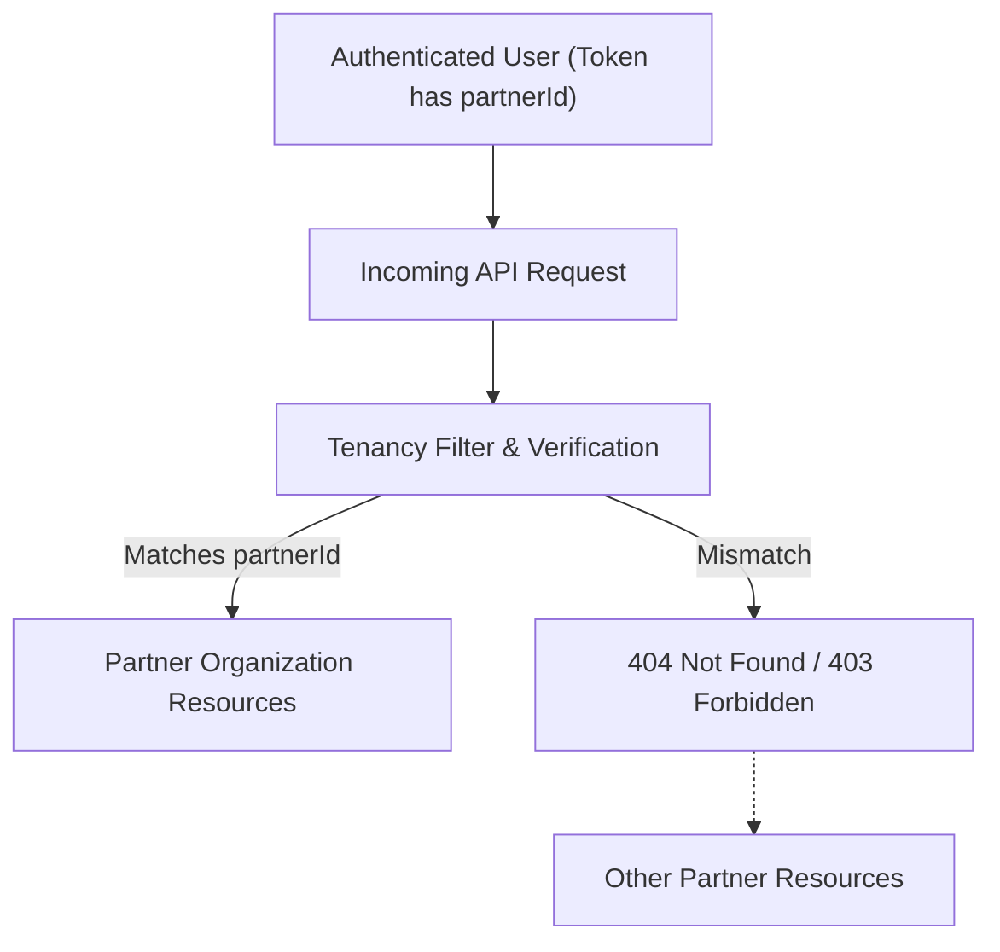

# 04 – RBAC and Partner Multi-Tenancy

## 1. Multi-Tenant Isolation Architecture
The platform enforces a strict multi-tenant boundary anchored on `partnerId`:
- Each theatre partner owns an organization identified by `partnerId`.
- Theatres, branches, screens, seating layouts, shows, bookings, and financial statements are indexed and queried strictly via `partnerId`.
- Even when querying by direct IDs (e.g., `GET /screens/:screenId`), the backend confirms the resource's associated theatre belongs to the authenticated partner's tenant boundary.



---

## 2. Role Permissions Matrix

| Feature / Action | THEATRE_OWNER | THEATRE_MANAGER | THEATRE_STAFF |
|---|:---:|:---:|:---:|
| **Register Partner Entity** | Yes | No | No |
| **Manage Theatres & Branches** | Create, Update, Delete | Update Only | Read Only |
| **Manage Screens & Layouts** | Full Control | Full Control | Read Only |
| **Publish Seating Layouts** | Yes | Yes | No |
| **Create & Reschedule Shows**| Yes | Yes | Read Only |
| **Cancel Shows & Issue Refunds** | Yes | Yes | No |
| **Configure Show Seat Pricing**| Yes | Yes | Read Only |
| **Search & View Bookings** | Yes | Yes | Yes |
| **Admit & Verify Tickets** | Yes | Yes | Yes |
| **View Revenue & Settlements**| Full Access | No | No |
| **Export Financial CSVs** | Full Access | No | No |
| **Assign / Revoke Staff** | Full Access | Full Access | No |

---

## 3. Frontend Route Guard Implementation
Routes are guarded using the `ProtectedRoute` component:
```jsx
<Route
  element={
    <ProtectedRoute
      allowedRoles={['THEATRE_OWNER', 'THEATRE_MANAGER']}
      requiredPermission="SCREEN_MANAGE"
    />
  }
>
  <Route path="/screens/:screenId/layout" element={<SeatLayoutBuilderPage />} />
</Route>
```
If a logged-in user lacks the required role or permission, they are shown a structured `403 Forbidden` access barrier with a quick link to return to their accessible dashboard sections.

