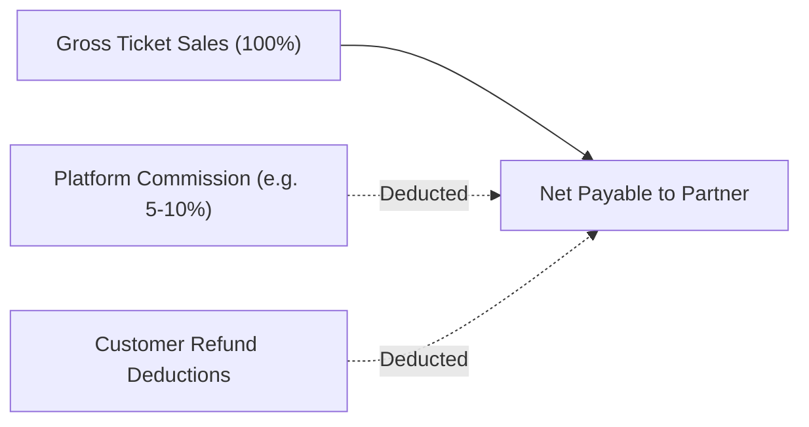

# 14 – Revenue and Settlements Audit

## 1. Financial Settlement Architecture
The platform provides theatre owners with complete transparency regarding ticket revenue, platform commissions, taxes, refund deductions, and net payouts.

---

## 2. Settlement Analytics Endpoints
- `GET /api/v1/owner/analytics/overview`: High-level summary of active shows, tickets sold, gross sales, platform fees, refunds, and net payable.
- `GET /api/v1/owner/analytics/revenue`: Date-range breakdown of settled transactions.
- **CSV Export**: Generates and downloads financial reports for partner accounting and GST reconciliation.

