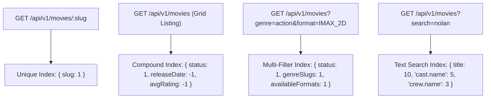

# 02. Movie Database Design & Schema Architecture

## 1. Executive Summary

The database architecture for the Movie Management module balances **read throughput** with **referential integrity**. In production movie ticketing platforms, catalog read operations outnumber catalog writes by more than 100,000 to 1. Consequently, high-frequency read data (cast, crew, media assets, format options) are modeled as **embedded sub-documents**, while taxonomic masters (genres, spoken languages) are modeled as **normalized collections** with denormalized slug projections.

---

## 2. Collection Schemas

### 2.1 Collection: `genres`

Standard taxonomic genres for categorizing films (e.g., Action, Sci-Fi, Drama).

| Field Name | BSON Type | Required | Default | Validation & Constraints | Description |
| :--- | :--- | :---: | :---: | :--- | :--- |
| `_id` | `ObjectId` | Yes | Auto | BSON ObjectId | Primary Key |
| `name` | `String` | Yes | - | Trim, unique, 2-50 chars | Display name |
| `slug` | `String` | Yes | - | Lowercase hyphenated, unique | URL-friendly identifier |
| `description` | `String` | No | `""` | Trim, max 300 chars | Editorial description |
| `isActive` | `Boolean` | Yes | `true` | Boolean | Operational status |
| `deletedAt` | `Date` | No | `null` | ISO Date | Soft delete marker |
| `createdAt` | `Date` | Yes | Auto | ISO Date | Creation timestamp |
| `updatedAt` | `Date` | Yes | Auto | ISO Date | Last update timestamp |

#### Indexes
- `{ slug: 1 }` (unique)
- `{ name: 1 }` (unique)
- `{ isActive: 1, deletedAt: 1 }`

---

### 2.2 Collection: `languages`

Master records for spoken and subtitle languages (e.g., Hindi, English, Tamil, Telugu).

| Field Name | BSON Type | Required | Default | Validation & Constraints | Description |
| :--- | :--- | :---: | :---: | :--- | :--- |
| `_id` | `ObjectId` | Yes | Auto | BSON ObjectId | Primary Key |
| `name` | `String` | Yes | - | Trim, unique, 2-50 chars | Language name in English |
| `code` | `String` | Yes | - | 2-3 char ISO 639-1 code, unique | Standard code (e.g. `hi`, `en`, `ta`) |
| `nativeName` | `String` | No | `""` | Trim, max 50 chars | Native script name (e.g. `हिन्दी`) |
| `isActive` | `Boolean` | Yes | `true` | Boolean | Operational status |
| `deletedAt` | `Date` | No | `null` | ISO Date | Soft delete marker |
| `createdAt` | `Date` | Yes | Auto | ISO Date | Creation timestamp |
| `updatedAt` | `Date` | Yes | Auto | ISO Date | Last update timestamp |

#### Indexes
- `{ code: 1 }` (unique)
- `{ name: 1 }` (unique)
- `{ isActive: 1, deletedAt: 1 }`

---

### 2.3 Collection: `movies`

The core catalog entity storing complete film metadata, media, cast, crew, ratings, and lifecycle states.

| Field Name | BSON Type | Required | Default | Validation & Constraints | Description |
| :--- | :--- | :---: | :---: | :--- | :--- |
| `_id` | `ObjectId` | Yes | Auto | BSON ObjectId | Primary Key |
| `title` | `String` | Yes | - | Trim, 1-200 chars | Movie title |
| `originalTitle` | `String` | No | `null` | Trim, max 200 chars | Native/original title if different |
| `slug` | `String` | Yes | - | Lowercase hyphenated, unique | Unique URL slug |
| `synopsis` | `String` | Yes | - | Trim, 10-5000 chars | Full storyline plot |
| `shortDescription` | `String` | No | `""` | Trim, max 300 chars | Brief synopsis for mobile cards |
| `durationMins` | `Number` | Yes | - | Integer, 1 to 600 | Runtime in minutes |
| `releaseDate` | `Date` | Yes | - | ISO Date | Official theatrical premiere date |
| `endDate` | `Date` | No | `null` | ISO Date | Projected end of theatrical run |
| `censorRating` | `String` | Yes | - | Enum: `U`, `UA`, `UA_13_PLUS`, `UA_16_PLUS`, `A`, `S` | CBFC certification |
| `productionCountry`| `String` | No | `'India'` | Trim | Country of origin |
| `originalLanguageId`| `ObjectId`| No | `null` | Ref: `languages` | Primary spoken dialogue language |
| `genreIds` | `[ObjectId]` | Yes | - | Ref: `genres`, min 1 | Associated genre IDs |
| `genreSlugs` | `[String]` | Yes | - | Array of strings | Denormalized genre slugs for fast search |
| `languageIds` | `[ObjectId]` | Yes | - | Ref: `languages`, min 1 | Dubbed & release language IDs |
| `availableFormats` | `[String]` | Yes | `['2D']` | Enum: `2D`, `3D`, `IMAX_2D`, `IMAX_3D`, `4DX`, `ICE`, `DOLBY_CINEMA` | Exhibition projection formats |
| `cast` | `[SubDoc]` | No | `[]` | Embedded cast members | Starring cast list |
| `crew` | `[SubDoc]` | No | `[]` | Embedded crew members | Directors, writers, producers |
| `posterUrl` | `String` | Yes | - | Valid URL | Portrait poster (2:3 aspect ratio) |
| `bannerUrl` | `String` | No | `""` | Valid URL | Landscape banner (16:9 aspect ratio) |
| `backdropUrl` | `String` | No | `""` | Valid URL | High-res background wallpaper |
| `trailerUrl` | `String` | No | `""` | Valid YouTube/Vimeo URL | Promotional video streaming URL |
| `galleryImages` | `[String]` | No | `[]` | Array of image URLs | Production stills & gallery |
| `status` | `String` | Yes | `'DRAFT'` | Enum: `DRAFT`, `PENDING_APPROVAL`, `APPROVED`, `UPCOMING`, `NOW_SHOWING`, `COMPLETED`, `ARCHIVED`, `REJECTED` | Editorial & theatrical lifecycle status |
| `rejectionReason` | `String` | No | `""` | Trim, max 500 chars | Reason recorded if rejected |
| `approvedBy` | `ObjectId` | No | `null` | Ref: `users` | Super Admin who approved |
| `approvedAt` | `Date` | No | `null` | ISO Date | Approval timestamp |
| `createdBy` | `ObjectId` | No | `null` | Ref: `users` | Author user ID |
| `updatedBy` | `ObjectId` | No | `null` | Ref: `users` | Last modifier user ID |
| `avgRating` | `Number` | Yes | `0.0` | Range: `0.0` to `10.0` | Aggregate review score |
| `totalReviews` | `Number` | Yes | `0` | Non-negative integer | Total verified customer reviews |
| `isDeleted` | `Boolean` | Yes | `false` | Boolean | Soft delete flag |
| `deletedAt` | `Date` | No | `null` | ISO Date | Soft delete timestamp |
| `createdAt` | `Date` | Yes | Auto | ISO Date | Creation timestamp |
| `updatedAt` | `Date` | Yes | Auto | ISO Date | Last update timestamp |

---

## 3. Indexing Strategy & Performance Rationale

1. **Text Search Index (`MovieTextIndex`)**: Weighted full-text search across `title` (weight 10), `cast.name` (weight 5), and `crew.name` (weight 3).
2. **Compound Discovery Index (`{ status: 1, releaseDate: -1, avgRating: -1 }`)**: Satisfies the default movie listing and sorting queries with zero in-memory sort stages (`COLLSCAN` avoided).
3. **Multi-Filter Index (`{ status: 1, genreSlugs: 1, availableFormats: 1 }`)**: Powers the UI facet filter drawer (e.g. "Now Showing" + "Action" + "IMAX 3D").

