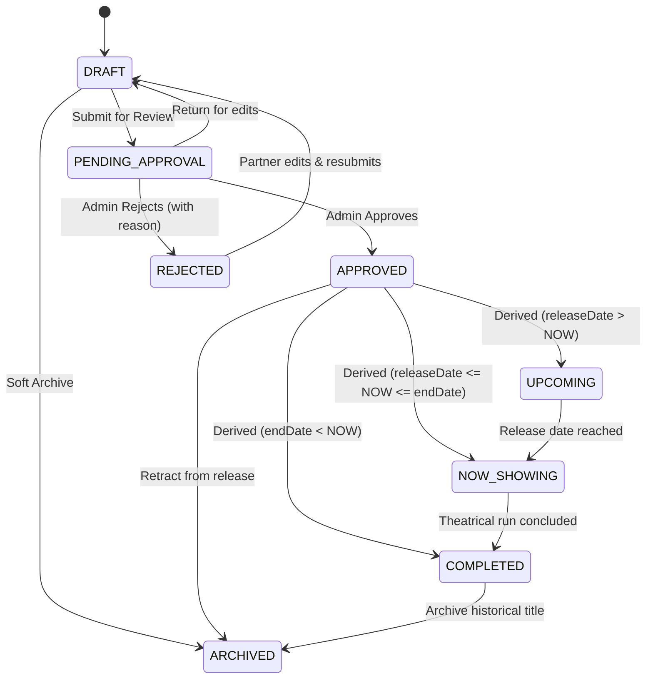

# Movie Module Business Rules and Invariants

This document specifies the core business invariants, status state machine rules, validation constraints, slug generation mechanisms, and referential integrity guarantees governing the **Movie Management Module**.

---

## 1. Slug Generation & Collision Resolution

Every movie, genre, and taxonomy item in the platform maintains a human-readable, URL-friendly unique identifier (`slug`).

### 1.1 Slugification Rules
1. All titles and names are normalized to lowercase.
2. Leading, trailing, and redundant whitespace are stripped.
3. Special symbols, punctuation marks, emojis, and non-alphanumeric characters (excluding hyphens) are removed.
4. Consecutive spaces or separators are compressed into a single hyphen (`-`).
5. Words are joined strictly with hyphens (e.g., `"Spider-Man: No Way Home"` becomes `"spider-man-no-way-home"`).

### 1.2 Collision Avoidance Algorithm
When a movie title produces a slug that already exists in the database:
1. The repository issues an existence check for the base slug.
2. If an active or soft-deleted movie already uses the exact slug, a sequential numeric suffix is appended:
   - Attempt 1: `{base-slug}-2`
   - Attempt 2: `{base-slug}-3`
   - Attempt $N$: `{base-slug}-N`
3. If an existing movie is updated and its title has not changed, its original slug is preserved to avoid breaking external deep links, bookmarks, and SEO rankings.

```
+-----------------------------------+
| Movie Title: "Dune: Part Two"     |
+-----------------+-----------------+
                  |
                  v
         [ Normalize & Trim ]
                  |
                  v
       "dune-part-two" (Base)
                  |
         [ Does slug exist? ]
          /              \
        Yes               No
        /                   \
   Append -2, -3...       Accept slug
```

---

## 2. Catalog Lifecycle & Status State Machine

The catalog lifecycle guarantees that movies undergo rigorous administrative quality and compliance review before appearing in public theatrical listings.

### 2.1 State Definitions

| Status | Code | Description | Publicly Visible |
| :--- | :--- | :--- | :--- |
| **Draft** | `DRAFT` | Initial movie entry created by theatre partner or content administrator. Incomplete or pending media assets. | ❌ No |
| **Pending Approval** | `PENDING_APPROVAL` | Submitted for compliance, metadata, and censor board verification. Locked from public view. | ❌ No |
| **Approved** | `APPROVED` | Verified by Super Admin / Platform Admin. Eligible for show scheduling and public indexing. | ✅ Yes |
| **Upcoming** | `UPCOMING` | Approved movie whose `releaseDate > NOW()`. Open for advance booking alerts or pre-sales. | ✅ Yes |
| **Now Showing** | `NOW_SHOWING` | Approved movie where `releaseDate <= NOW() <= endDate`. Actively running in cinema screens. | ✅ Yes |
| **Completed** | `COMPLETED` | Theatrical run ended (`endDate < NOW()`). Kept for historical reference. | ❌ No (Catalog) |
| **Rejected** | `REJECTED` | Rejected during compliance check due to licensing, copyright, or metadata issues. | ❌ No |
| **Archived** | `ARCHIVED` | Retired from active operations. | ❌ No |

---

### 2.2 Allowed State Transitions

Transitions between movie statuses are strictly validated by `isAllowedStatusTransition()`. Unregistered transitions result in a `400 Bad Request` (`INVALID_STATUS_TRANSITION`).



#### Transition Validation Matrix

| From \ To | DRAFT | PENDING_APPROVAL | APPROVED | REJECTED | ARCHIVED |
| :--- | :---: | :---: | :---: | :---: | :---: |
| **DRAFT** | — | ✅ | ❌ | ❌ | ✅ |
| **PENDING_APPROVAL** | ✅ | — | ✅ | ✅ | ❌ |
| **APPROVED** | ❌ | ❌ | — | ❌ | ✅ |
| **REJECTED** | ✅ | ❌ | ❌ | — | ✅ |
| **ARCHIVED** | ❌ | ❌ | ❌ | ❌ | — |

---

## 3. Dynamic Theatrical Status Derivation

While `status` records the administrative approval state, discovery endpoints dynamically evaluate the operational theatrical state (`deriveTheatricalStatus`) for approved movies:

$$\text{Effective Status} = \begin{cases} 
\text{UPCOMING} & \text{if } \text{status} = \text{APPROVED} \land \text{NOW}() < \text{releaseDate} \\
\text{NOW\_SHOWING} & \text{if } \text{status} = \text{APPROVED} \land \text{releaseDate} \le \text{NOW}() \le \text{endDate} \\
\text{COMPLETED} & \text{if } \text{status} = \text{APPROVED} \land \text{endDate} < \text{NOW}() \\
\text{status} & \text{otherwise}
\end{cases}$$

This ensures that:
- Movies automatically graduate to `NOW_SHOWING` on midnight of their release date without requiring scheduled batch cron jobs to flip database flags.
- Movies automatically cease appearing in active now-showing rails after their contractual theatrical window ends.

---

## 4. Age Certification & Compliance Standards

The system adheres to statutory movie ratings boards (such as the Central Board of Film Certification — CBFC, and international MPAA mappings):

| Certification Code | Rating Name | Age Criteria & Guidance |
| :--- | :--- | :--- |
| `U` | Universal | Unrestricted public exhibition; suitable for all age groups. |
| `UA` | Universal Adult (Legacy) | Parental guidance advised for children under 12 years. |
| `UA7_PLUS` | U/A 7+ | Suitable for viewers aged 7 and above; parental guidance for under 7. |
| `UA13_PLUS` | U/A 13+ | Suitable for viewers aged 13 and above; parental guidance for under 13. |
| `UA16_PLUS` | U/A 16+ | Suitable for viewers aged 16 and above; parental guidance for under 16. |
| `A` | Adult | Strictly restricted to viewers aged 18 and above. Age verification required at cinema entrance. |
| `S` | Special | Restricted to specialized audiences (doctors, scientists, researchers). |

---

## 5. Public Visibility Invariants

Security and content isolation mandate that unapproved catalog entries are never leaked to customers:

1. **Strict Query Predicate**: Every public query (`GET /api/v1/movies`, `GET /api/v1/movies/now-showing`, `GET /api/v1/movies/upcoming`, `GET /api/v1/movies/:slug`) automatically injects:
   ```javascript
   {
     status: { $in: ['APPROVED', 'UPCOMING', 'NOW_SHOWING'] },
     isDeleted: false
   }
   ```
2. **Slug Lookup Isolation**: If a public user requests a movie by slug, and that movie exists in `DRAFT`, `PENDING_APPROVAL`, `REJECTED`, or `isDeleted: true`, the API returns `404 Not Found` with code `MOVIE_NOT_FOUND`. It never returns `403 Forbidden` for missing public status to avoid leaking the existence of unpublished titles.

---

## 6. Referential Integrity & Deletion Rules

### 6.1 Genre and Language Protection
- A genre or language cannot be deleted or soft-deleted if active movies reference its ObjectId (`GenreRepository.isReferencedInMovies`, `LanguageRepository.isReferencedInMovies`).
- Attempting to delete an assigned taxonomy record returns `409 Conflict` with error code `RESOURCE_IN_USE`.

### 6.2 Soft Deletion Invariant
- **No Hard Deletes**: Movies are never removed with `deleteOne()` or `deleteMany()`.
- Deleting a movie invokes a soft-delete:
  ```javascript
  {
    isDeleted: true,
    deletedAt: new Date()
  }
  ```
- Soft-deleted movies are excluded from all public listings, admin listing queries by default, and cannot be scheduled for upcoming showtimes.
- This preserves referential integrity with existing bookings, customer transaction receipts, financial audit logs, and analytics.

