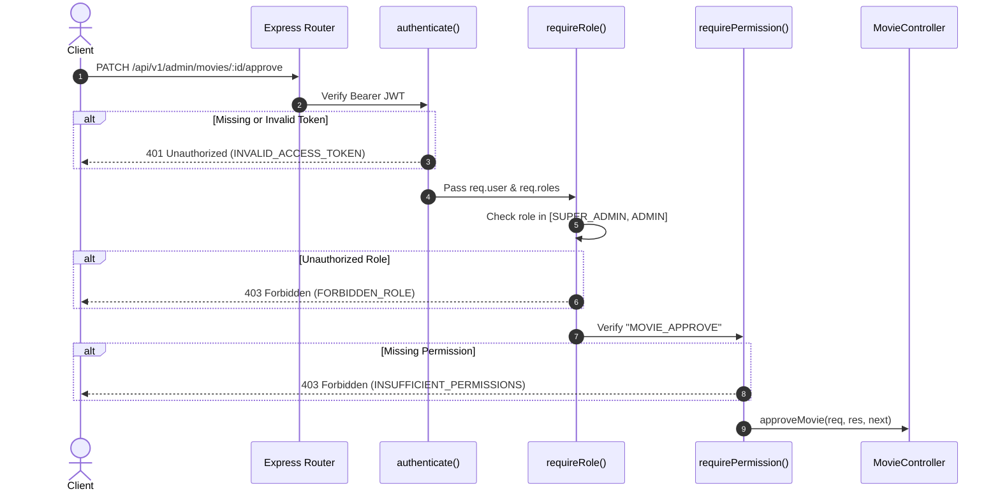

# Movie Module Role-Based Access Control (RBAC) & Permissions

This document outlines the security architecture, authorization matrix, permission boundaries, and role enforcement mechanisms across the **Movie Management Module**.

---

## 1. Permission Constants

The movie domain defines the following granular system permissions:

| Permission Key | Description | Scope |
| :--- | :--- | :--- |
| `MOVIE_CREATE` | Ability to submit new movie metadata and media assets | Admin & Theatre Partners |
| `MOVIE_READ` | Ability to view internal/unapproved movie records and audit fields | Administrative |
| `MOVIE_UPDATE` | Ability to edit existing movie metadata, cast, crew, and assets | Admin & Movie Authors |
| `MOVIE_DELETE` | Ability to soft-delete movies from the system | Platform Administrators |
| `MOVIE_APPROVE` | Ability to approve or reject movies for theatrical exhibition | Platform Compliance Admins |
| `GENRE_MANAGE` | Ability to create, update, and retire system-wide genres | System Administrators |
| `LANGUAGE_MANAGE` | Ability to create, update, and retire system-wide languages | System Administrators |

---

## 2. Role-Based Access Control (RBAC) Matrix

The table below details permissions granted to each user role within the platform:

| Action / Endpoint | Super Admin | Platform Admin | Theatre Owner | Customer | Guest (Public) |
| :--- | :---: | :---: | :---: | :---: | :---: |
| **Browse Public Movies** (`GET /movies`) | ✅ | ✅ | ✅ | ✅ | ✅ |
| **View Movie Details** (`GET /movies/:slug`) | ✅ | ✅ | ✅ | ✅ | ✅ |
| **View Active Genres/Languages** (`GET /genres`, `/languages`) | ✅ | ✅ | ✅ | ✅ | ✅ |
| **Create Movie Draft** (`POST /admin/movies`) | ✅ | ✅ | ✅ | ❌ | ❌ |
| **View All Admin Movies** (`GET /admin/movies`) | ✅ | ✅ | ❌ (Own only) | ❌ | ❌ |
| **Update Movie** (`PATCH /admin/movies/:id`) | ✅ | ✅ | ✅ (Drafts only) | ❌ | ❌ |
| **Soft Delete Movie** (`DELETE /admin/movies/:id`) | ✅ | ✅ | ❌ | ❌ | ❌ |
| **Approve Movie** (`PATCH /admin/movies/:id/approve`) | ✅ | ✅ | ❌ | ❌ | ❌ |
| **Reject Movie** (`PATCH /admin/movies/:id/reject`) | ✅ | ✅ | ❌ | ❌ | ❌ |
| **Manage Genres** (`POST/PATCH/DELETE /admin/genres`) | ✅ | ✅ | ❌ | ❌ | ❌ |
| **Manage Languages** (`POST/PATCH/DELETE /admin/languages`) | ✅ | ✅ | ❌ | ❌ | ❌ |

---

## 3. Multi-Tenant Role Isolation & Invariants

### 3.1 Super Admin & Platform Admin
- Possess complete administrative sovereignty across all regional territories, genres, languages, and theatrical catalogs.
- Capable of approving, rejecting, or archiving any catalog entry.
- Can override metadata or censor certifications if required by regulatory mandates.

### 3.2 Theatre Owner Constraints
- **Separation of Duties**: Theatre owners can propose new movies (e.g., local indie releases or special screenings) by creating a record with `POST /api/v1/admin/movies`.
- **Approval Guard**: Movies created by theatre owners are always initialized with status `DRAFT` or `PENDING_APPROVAL`. Theatre owners cannot approve their own movies (`MOVIE_APPROVE` permission denied).
- **Edit Restrictions**: Once a movie is marked `APPROVED`, theatre owners cannot mutate censor ratings, duration, or core taxonomy.

### 3.3 Customer & Guest Safeguards
- Zero administrative exposure: Non-privileged users have access only to public discovery routes (`/api/v1/movies/*`, `/api/v1/genres`, `/api/v1/languages`).
- Database filtering automatically forces `{ status: { $in: PublicVisibleStatuses }, isDeleted: false }` at the repository query level, preventing any information disclosure regarding unreleased or pending films.

---

## 4. Middleware Enforcement Architecture

The module utilizes the unified authentication and authorization middleware pipeline established in Part 4:



### Route Guard Implementation Example

From `apps/backend/src/modules/movies/movie.routes.js`:

```javascript
// Admin movie routes mounting with strict authentication & permission guards
movieAdminRoutes.use(authenticate);

movieAdminRoutes.post(
  '/',
  requireRole(['SUPER_ADMIN', 'ADMIN', 'THEATRE_OWNER']),
  requirePermission('MOVIE_CREATE'),
  validate(createMovieSchema),
  movieController.createMovie
);

movieAdminRoutes.patch(
  '/:movieId/approve',
  requireRole(['SUPER_ADMIN', 'ADMIN']),
  requirePermission('MOVIE_APPROVE'),
  validate(paramMovieIdSchema, 'params'),
  movieController.approveMovie
);
```

