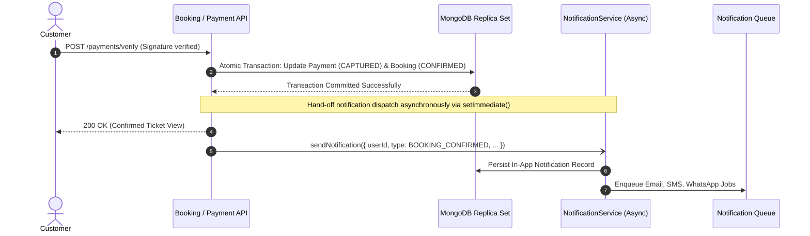

# Part 12 — Notification Events & Business Lifecycle Integration

## 1. Overview

The platform defines a centralized taxonomy of notification events across authentication, ticket booking, payment processing, theatre onboarding, and administrative governance.

Notifications are strictly triggered **after** the corresponding business state transition has atomically committed in the primary database. For example, booking confirmations are never triggered before payment verification is complete.

---

## 2. Master Event Catalog

| Event Key | Category | Triggering Domain Action | Default Channels | Description |
| :--- | :--- | :--- | :--- | :--- |
| `AUTH_WELCOME` | `TRANSACTIONAL` | Customer account registration | In-App, Email | Welcomes customer to the platform with getting started tips. |
| `AUTH_OTP` | `SECURITY` | Phone/Email verification | SMS, Email | High-priority 6-digit one-time code (valid 10 minutes). |
| `AUTH_PASSWORD_CHANGED` | `SECURITY` | Password update or recovery | Email, In-App | Security advisory warning user of password change. |
| `AUTH_PASSWORD_RESET` | `SECURITY` | Forgot password requested | Email | Cryptographic reset token link (valid 15 minutes). |
| `BOOKING_CREATED` | `TRANSACTIONAL` | Checkout reservation initiated | In-App | Informs user seats are reserved and timer is counting down. |
| `BOOKING_CONFIRMED` | `TRANSACTIONAL` | Payment verified & captured | In-App, Email, SMS, WhatsApp | Core confirmation alert containing booking reference, digital ticket QR link, auditorium details, and seat numbers. |
| `BOOKING_CANCELLED` | `TRANSACTIONAL` | Booking cancelled by user | In-App, Email, SMS | Cancellation confirmation with refund eligibility summary. |
| `BOOKING_EXPIRED` | `TRANSACTIONAL` | Countdown elapsed without payment | In-App | Informs user reservation expired and seats were released. |
| `SHOW_CANCELLED` | `TRANSACTIONAL` | Screen/show cancelled by partner | In-App, Email, SMS | Urgent advisory informing patron of cancellation and automatic reverse refund initiation. |
| `SHOW_RESCHEDULED` | `TRANSACTIONAL` | Show timing modified | In-App, Email, SMS | Notice detailing updated screening date/time. |
| `TICKET_AVAILABLE` | `MARKETING` | Watchlist movie bookings open | In-App, Email | Re-engagement notification when tickets open in customer city. |
| `PAYMENT_SUCCESS` | `TRANSACTIONAL` | Payment captured on gateway | In-App, Email, SMS | Commercial receipt with transaction ID and payment instrument. |
| `PAYMENT_FAILED` | `TRANSACTIONAL` | Payment declined by issuing bank | In-App, Email | Notice advising customer to retry with alternate payment card. |
| `REFUND_INITIATED` | `TRANSACTIONAL` | Refund requested and queued | In-App | Settlement notice indicating refund is being processed. |
| `REFUND_PROCESSED` | `TRANSACTIONAL` | Gateway settles refund payout | In-App, Email, SMS | Confirmation with gateway refund ID and banking settlement timeframe (5-7 business days). |
| `REFUND_FAILED` | `TRANSACTIONAL` | Gateway payout error | In-App, Email | Alert informing customer/admin of payout failure. |
| `THEATRE_SUBMITTED` | `SYSTEM` | Partner KYC onboarding submitted | Email | Acknowledgement to partner that submission is pending review. |
| `THEATRE_APPROVED` | `SYSTEM` | Admin approves cinema complex | In-App, Email | Welcome partner to live platform with dashboard link. |
| `THEATRE_REJECTED` | `SYSTEM` | Admin rejects cinema application | Email | Explanatory rejection letter with correction instructions. |
| `THEATRE_SUSPENDED` | `SYSTEM` | Admin suspends partner account | Email | Operational suspension notice. |
| `THEATRE_REACTIVATED` | `SYSTEM` | Admin restores partner account | Email | Reactivation notice. |
| `SYSTEM_ANNOUNCEMENT`| `SYSTEM` | Super Admin broadcast | In-App, Email | Maintenance advisories, feature updates, platform news. |
| `SECURITY_ALERT` | `SECURITY` | Suspicious login or token family reuse | Email, In-App | Critical security alert; cannot be disabled by user. |

---

## 3. Transactional Safety & Non-Blocking Invariant

External message delivery must **never** block or jeopardize the atomic completion of business transactions.

**Guarantees**:
1. If the email gateway experiences a network outage, the customer receives their confirmed booking and ticket QR code in 200ms without seeing a 500 error.
2. Failed external deliveries are retried via background queues without rolling back the database transaction.

