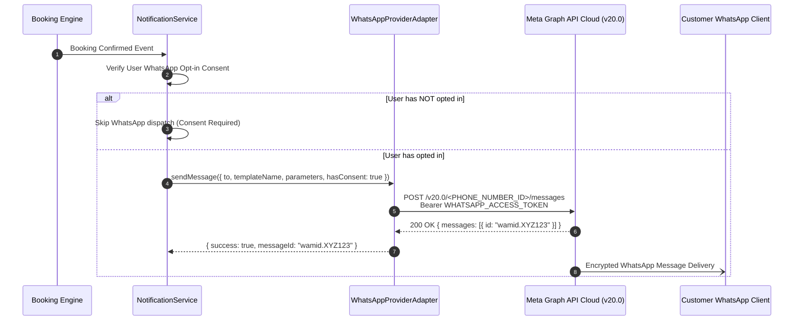

# Part 12 — Official WhatsApp Business Cloud API Integration

## 1. Overview

WhatsApp has become the preferred consumer channel for ticket delivery in India and Southeast Asia. The platform integrates exclusively with the **Official Meta WhatsApp Business Platform Cloud API**, strictly prohibiting unofficial browser automation, reverse-engineered web clients, or scraping tools.

---

## 2. Meta WhatsApp Business Cloud Architecture



---

## 3. Explicit User Consent & Opt-In Invariants

Under Meta WhatsApp Business Policy and statutory privacy laws:
1. **Explicit Opt-in Requirement**: Businesses must obtain explicit opt-in consent before initiating conversation templates with customers.
2. **Opt-in Timestamping**: The platform stores `whatsappConsent: Boolean` and `whatsappConsentAt: Date` in `NotificationPreference`.
3. **Opt-Out Guarantee**: Users can withdraw consent at any time via `PATCH /api/v1/notifications/preferences` (`whatsappConsent: false`). Once disabled, the system immediately halts all outbound WhatsApp traffic to that number.
4. **No Promotional Spam**: Marketing or promotional messages cannot be dispatched over WhatsApp unless the user has explicitly enabled promotional updates in addition to granting WhatsApp channel consent.

---

## 4. Approved Template Structure

Outbound messages use Meta-approved pre-registered templates:

### Sample Template: `bms_booking_confirmed`
- **Category**: `UTILITY`
- **Language**: `en`
- **Body**:
  > *"Hi {{1}}, your booking {{2}} for {{3}} is confirmed! Seats: {{4}} at {{5}} ({{6}} {{7}}). View digital ticket: {{8}}"*
- **Parameters Mapping**:
  - `{{1}}`: `customerName`
  - `{{2}}`: `bookingReference`
  - `{{3}}`: `movieTitle`
  - `{{4}}`: `seatLabels`
  - `{{5}}`: `theatreName`
  - `{{6}}`: `showDate`
  - `{{7}}`: `showTime`
  - `{{8}}`: `ticketUrl`

---

## 5. Environment Variables & Credentials

```bash
WHATSAPP_PROVIDER=mock                     # 'mock' | 'whatsapp_cloud'
WHATSAPP_PHONE_NUMBER_ID=109876543210987   # From Meta App Dashboard
WHATSAPP_ACCESS_TOKEN=EAAG...              # System User Permanent Access Token
WHATSAPP_BUSINESS_ACCOUNT_ID=209876543210  # WABA ID
```

