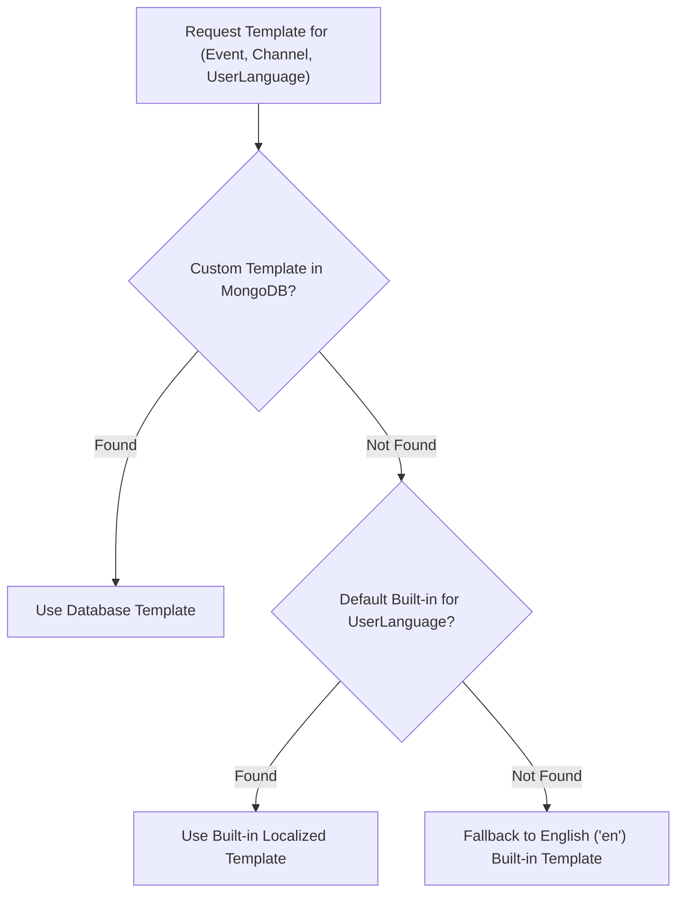

# Part 12 — Template Engine & Multi-Lingual Localization

## 1. Overview

Notification copy must be maintainable, localized, dynamic, and resilient against injection attacks. The `TemplateEngine` subsystem compiles reusable notification templates across Email, SMS, WhatsApp, and In-App channels with dynamic variable substitution and multi-lingual fallback.

---

## 2. Dynamic Variable Syntax & HTML Sanitization

Templates utilize curly brace interpolation:
- `{{variableName}}`: Automatically sanitized via `TemplateEngine.escapeHtml()` when `isHtml: true`. Special characters (`<`, `>`, `&`, `"`, `'`) are converted to HTML entities to prevent Cross-Site Scripting (XSS).
- `{{{rawVariable}}}`: Preserves raw markup (used exclusively for trusted, pre-rendered layout blocks).

### Variable Validation
Before dispatch, `TemplateEngine.validateVariables(requiredVars, data)` verifies that all required dynamic tokens are populated:
```javascript
const outcome = TemplateEngine.validateVariables(['movieTitle', 'bookingReference'], data);
if (!outcome.valid) {
  logger.warn({ missing: outcome.missing }, 'Template missing required variables');
}
```

---

## 3. Multi-Lingual Architecture (English, Hindi, Gujarati)

The platform supports India's linguistic diversity with built-in localized templates across three languages:
1. **English (`en`)**: Universal default fallback.
2. **Hindi (`hi`)**: Devanagari script for North and Central Indian audiences.
3. **Gujarati (`gu`)**: Gujarati script for Western Indian regional audiences.

### Resolution Waterfall



---

## 4. Built-in Template Catalog Samples

### A. Booking Confirmation (`BOOKING_CONFIRMED`)
- **English**: *"Your movie ticket is confirmed! - {{bookingReference}}"*
- **Hindi**: *"आपका मूवी टिकट कन्फर्म हो गया है! - {{bookingReference}}"*
- **Gujarati**: *"તમારી મૂવી ટિકિટ કન્ફર્મ થઈ ગઈ છે! - {{bookingReference}}"*

### B. Payment Receipt (`PAYMENT_SUCCESS`)
- *"Payment Successful - ₹{{amount}} received for booking {{bookingReference}}"*

### C. Refund Settlement (`REFUND_PROCESSED`)
- *"Refund Processed - ₹{{refundAmount}} for booking {{bookingReference}}"*

