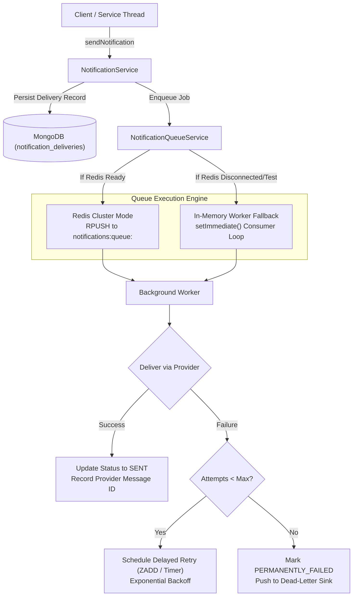

# Part 12 — Background Queue Architecture & Worker Execution

## 1. Overview

Delivering messages through external third-party gateways (email relays, telecom SMS gateways, WhatsApp Cloud endpoints) involves unpredictable latency (200ms to 5,000ms), network timeouts, rate limit throttling, and upstream service outages.

The `NotificationQueueService` implements an asynchronous background processing model that decouples user request threads from outbound network operations.

---

## 2. Queue Architecture & Dual Mode Operation

---

## 3. Worker Execution Loop & Fault Tolerance

1. **Job Consumption**:
   - Each queue corresponds to a channel: `notifications:queue:email`, `notifications:queue:sms`, `notifications:queue:whatsapp`.
   - The worker retrieves the job payload and loads the associated `NotificationDelivery` record.
2. **Terminal Guard**:
   - If the delivery is already `SENT` or `DELIVERED`, the worker treats the job as an idempotent no-op and exits immediately.
3. **Status Transition**:
   - Transitions delivery status to `PROCESSING` to prevent duplicate concurrent runs.
4. **Application Restart Resilience**:
   - Delivery records in MongoDB maintain persistent state. If the process restarts midway, pending `QUEUED` and `RETRYING` jobs are picked up upon startup.

