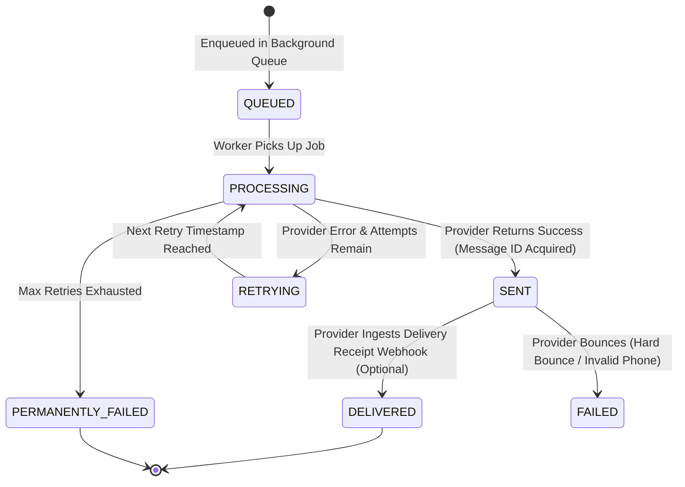

# Part 12 — Delivery Tracking, Status Lifecycles & Monitoring

## 1. Overview

Accurate tracking of every outbound message is essential for customer support, operational audits, vendor SLA monitoring, and financial dispute resolution. The `notification_deliveries` collection serves as an immutable delivery audit ledger.

---

## 2. Delivery Status Finite State Machine



### Status Definitions

| Status | Meaning & Criteria |
| :--- | :--- |
| `QUEUED` | Job created in database and registered in Redis/in-memory dispatch queue. |
| `PROCESSING` | Worker has dequeued the job and is actively transmitting to upstream provider. |
| `SENT` | Gateway has accepted the message and returned an official `messageId`. |
| `DELIVERED` | End-user device delivery confirmed (for providers supporting delivery receipts). |
| `RETRYING` | Temporary failure (e.g. rate limit, connection reset); scheduled for backoff. |
| `FAILED` | Terminal rejection by provider (e.g. invalid phone number, blacklisted email). |
| `PERMANENTLY_FAILED` | Job reached maximum retry ceiling without success; routed to dead-letter sink. |

---

## 3. Delivery Record Audit Schema

```json
{
  "_id": "65f1a2b3c4d5e6f7a8b9c077",
  "notificationId": "65f1a2b3c4d5e6f7a8b9c099",
  "userId": "65f1a2b3c4d5e6f7a8b9c001",
  "channel": "EMAIL",
  "provider": "RESEND",
  "providerMessageId": "msg_9944a1b2c3d4",
  "recipient": "customer@example.com",
  "deliveryStatus": "SENT",
  "idempotencyKey": "idemp:CONFIRM:BK-20261030-XYZ789:EMAIL",
  "attemptCount": 1,
  "maxAttempts": 3,
  "lastError": null,
  "retryHistory": [],
  "sentAt": "2026-10-30T10:02:15.000Z",
  "deliveredAt": null,
  "createdAt": "2026-10-30T10:02:14.000Z"
}
```

---

## 4. Operational Monitoring & Aggregated Stats

Super Administrators can inspect real-time delivery health via `GET /api/v1/admin/notifications/stats`:
- Aggregation by `deliveryStatus` (e.g. count of `SENT`, `RETRYING`, `PERMANENTLY_FAILED`).
- Aggregation by `channel` (distribution across `EMAIL`, `SMS`, `WHATSAPP`, `IN_APP`).

