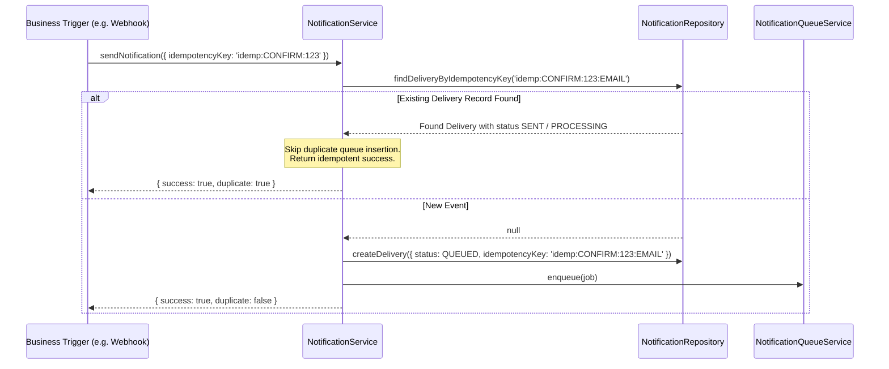

# Part 12 — Deduplication, Idempotency & Exponential Backoff Retries

## 1. Overview

In distributed architectures with background retries and duplicate webhooks, duplicate notifications (such as receiving three identical confirmation emails or SMS receipts for a single movie booking) severely damage brand credibility and waste financial credits.

This document details the multi-layer deduplication and retry policies implemented in Part 12.

---

## 2. Notification Deduplication Architecture

Every delivery request supports an optional, business-derived `idempotencyKey`:
$$\text{idempotencyKey} = \text{"idemp:"} + \text{EventType} + \text{":"} + \text{BusinessEntityId} + \text{":"} + \text{Channel}$$

For example: `idemp:CONFIRM:65f1a2b3c4d5e6f7a8b9c099:EMAIL`.

### Database Guarantee
- `notification_deliveries` enforces a sparse unique index on `{ idempotencyKey: 1 }`.
- Even under concurrent race conditions where two threads attempt to create a delivery simultaneously, MongoDB's unique index constraint halts the duplicate insertion (`E11000 duplicate key error`).

---

## 3. Exponential Backoff Retry Policy

When an external provider fails with a retryable error (e.g. HTTP 429 Too Many Requests, HTTP 503 Service Unavailable, socket hangup):

$$\text{Delay}(n) = \min\left(\text{initialBackoff} \times 2^{n-1},\; \text{maxBackoff}\right)$$

With standard configuration ($\text{initialBackoff} = 5\text{s}$, $\text{maxBackoff} = 3600\text{s}$):
- **Attempt 1**: Immediate dispatch ($0\text{s}$)
- **Attempt 2**: $5 \times 2^0 = 5\text{s}$
- **Attempt 3**: $5 \times 2^1 = 10\text{s}$
- **Attempt 4**: $5 \times 2^2 = 20\text{s}$

### Retry History Audit Trail
Every retry attempt appends a historical entry to `retryHistory` containing the attempt index, exact ISO timestamp, and upstream error message for post-mortem analysis.

---

## 4. Dead-Letter Queue (DLQ) Routing

When a job exhausts its `maxAttempts` (default: 3):
1. The delivery record status transitions to `PERMANENTLY_FAILED`.
2. The job payload is routed to Redis key `notifications:dead_letter`.
3. An error-level log is emitted with full diagnostic context (recipient, channel, final error reason).
4. Critical alerts trigger internal ops notifications without blocking application availability.

