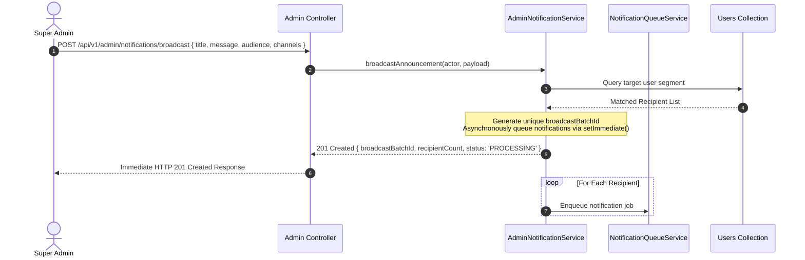

# Part 12 — Administrative Notification Management & Broadcasts

## 1. Overview

Platform administrators require centralized tools to broadcast system-wide maintenance alerts, governance notices, and emergency advisories to specific segments of users, while reviewing cross-platform delivery health.

---

## 2. Role-Based Access Controls (RBAC)

- **Super Administrator (`SUPER_ADMIN`)**:
  - Exclusive authority to call `POST /api/v1/admin/notifications/broadcast`.
  - Full visibility into platform-wide delivery analytics (`GET /api/v1/admin/notifications/stats`) and full notification logs (`GET /api/v1/admin/notifications`).
- **Theatre Owners & Managers (`THEATRE_OWNER`, `THEATRE_MANAGER`)**:
  - Prohibited from sending platform-wide broadcasts (returns `403 Forbidden`).
  - May only receive notifications related to their onboarding status and operational screenings.
- **Customers (`CUSTOMER`)**:
  - Strictly forbidden from administrative notification endpoints (returns `403 Forbidden`).

---

## 3. Audience Targeting & Segmentation

Broadcast announcements support targeted audience segmentation:

| Audience Filter | Target Cohort | Selection Criteria in MongoDB |
| :--- | :--- | :--- |
| `ALL` | Entire active user base | `{ isActive: true, deletedAt: null }` |
| `CUSTOMERS` | Retail ticket patrons only | `{ role: 'CUSTOMER', isActive: true, deletedAt: null }` |
| `THEATRE_OWNERS` | Cinema partners and managers | `{ role: { $in: ['THEATRE_OWNER', 'THEATRE_MANAGER'] }, isActive: true }` |

---

## 4. Broadcast Workflow & Non-Blocking Chunking

Broadcasts targeting tens of thousands of users must not monopolize HTTP request threads or exceed database memory:

---

## 5. Administrative Endpoints Summary

- `POST /api/v1/admin/notifications/broadcast`: Initiate segment announcement.
- `GET /api/v1/admin/notifications`: List platform notifications with pagination and type filtering.
- `GET /api/v1/admin/notifications/stats`: Real-time status breakdown (sent, retrying, permanently failed).
- `GET /api/v1/admin/notifications/:id`: Deep-dive inspection of a specific notification and all its per-channel delivery attempts.

