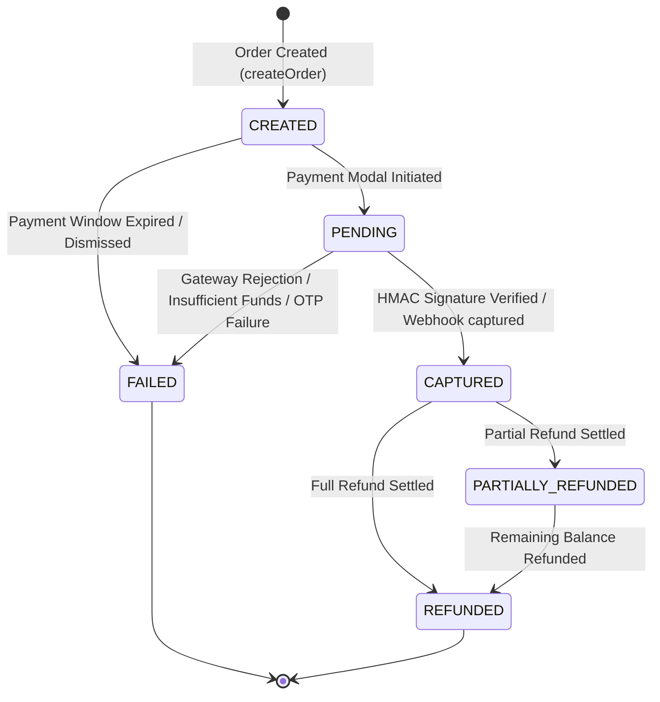
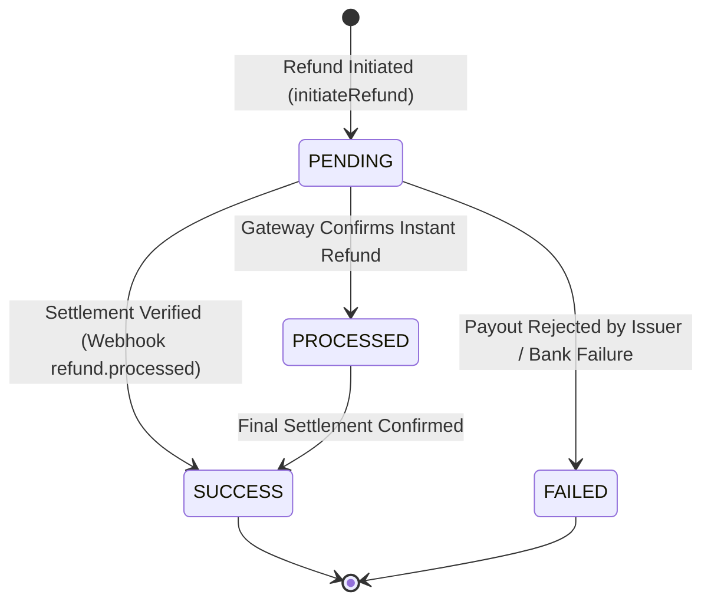

# Part 11 — Payment & Refund Lifecycle State Machines

## 1. Overview

Financial transactions must strictly adhere to a deterministic Finite State Machine (FSM). Arbitrary or jumping state changes are prevented at the domain layer. Every transition logs an audit record with timestamp, executing actor, and contextual metadata.

---

## 2. Payment Lifecycle State Machine



### Valid Transition Matrix

| Current Status | Allowed Next Statuses | Trigger Event |
| :--- | :--- | :--- |
| `CREATED` | `PENDING`, `CAPTURED`, `FAILED` | Customer launches checkout, completes payment directly, or order is cancelled. |
| `PENDING` | `CAPTURED`, `FAILED` | Gateway verifies transaction capture or records authorization failure. |
| `CAPTURED` | `PARTIALLY_REFUNDED`, `REFUNDED` | Merchant or administrator issues authorized refund. |
| `PARTIALLY_REFUNDED` | `REFUNDED` | Successive refunds exhaust the remaining original payment balance. |
| `REFUNDED` | *None (Terminal)* | Immutable terminal state. |
| `FAILED` | *None (Terminal)* | Immutable terminal state. |

---

## 3. Refund Lifecycle State Machine



### Transition Validation Rules

1. **Instant Refund vs Batch Settlement**:
   - Razorpay API instant refunds return status `processed` immediately upon API call completion.
   - The platform maps initial creation to `SUCCESS` if settled synchronously, or `PENDING` if queued by the gateway.
2. **Terminal Guarding**:
   - Terminal states (`SUCCESS`, `FAILED`) reject further state transitions.
   - If a webhook reports `refund.failed` for a previously pending refund, the refund is marked `FAILED` and logged for operational intervention.

---

## 4. Status History Audit Trail

Both the `Payment` and `Refund` models embed an audit trail subdocument array (`statusHistory`):

```json
{
  "statusHistory": [
    {
      "status": "CREATED",
      "timestamp": "2026-10-30T10:00:00.000Z",
      "actorId": "65f1a2b3c4d5e6f7a8b9c001",
      "note": "Payment order generated for booking BK-20261030-XYZ789"
    },
    {
      "status": "CAPTURED",
      "timestamp": "2026-10-30T10:02:15.000Z",
      "actorId": "65f1a2b3c4d5e6f7a8b9c001",
      "note": "Client signature verified and booking confirmed"
    }
  ]
}
```

This guarantees end-to-end historical traceability for financial audits and customer support disputes.

