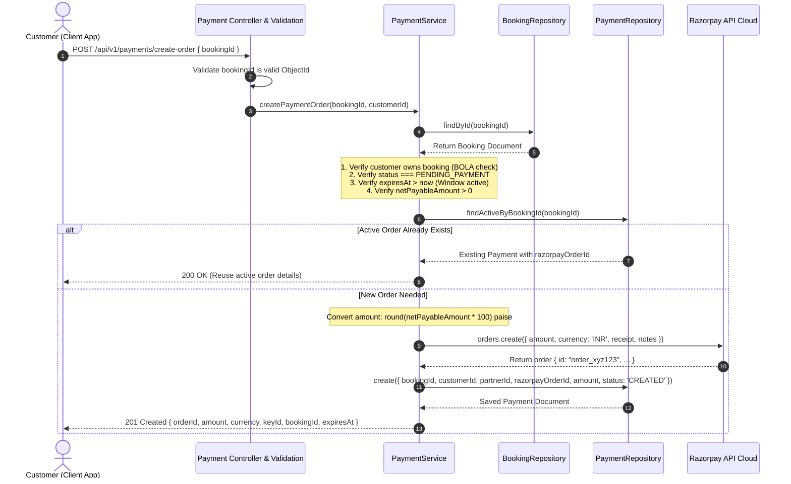

# Part 11 — Create Payment Order Workflow

## 1. Overview

The Order Creation workflow (`POST /api/v1/payments/create-order`) is the initial step connecting a user's ticket reservation with the payment processor. It enforces booking eligibility, prevents race conditions, enforces server-side pricing, and registers a traceable payment record before the client opens the Razorpay checkout frame.

---

## 2. Sequence Workflow Diagram



---

## 3. Pre-Condition Validation Invariants

Before calling the Razorpay API, `PaymentService.createPaymentOrder` enforces 5 strict invariants:

1. **Existence**: The booking must exist in MongoDB (`BOOKING_NOT_FOUND`, 404).
2. **Ownership (BOLA)**: `booking.customerId.toString() === customerId.toString()` (`BOOKING_NOT_FOUND`, 404) to avoid leaking existence of another customer's booking.
3. **Status Check**: The booking must be in `PENDING_PAYMENT` status. If already `CONFIRMED` or `CANCELLED`, throw `CONFLICT` (409).
4. **Expiration Time**: `booking.expiresAt > new Date()`. If the 5-minute checkout countdown has elapsed, throw `BOOKING_ALREADY_EXPIRED` (409).
5. **Positive Payable Balance**: `booking.netPayableAmount > 0`. If a 100% promotional discount reduced the bill to zero, the user must use direct zero-payment confirmation instead of generating a gateway order.

---

## 4. Integer Paise Arithmetic

Razorpay processes transaction amounts as integer multiples of the smallest currency subunit (paise for INR). All float values are converted and rounded using `Math.round(amount * 100)`:

```javascript
const amountPaise = Math.round(booking.netPayableAmount * 100);
if (amountPaise <= 0) {
  throw new AppError('Booking payable amount must be greater than zero to create a payment order', HttpStatus.BAD_REQUEST, ErrorCodes.INVALID_PAYMENT_AMOUNT);
}
```

This prevents floating-point inaccuracies from generating mismatched transaction figures.

---

## 5. Idempotent Order Reuse

If a user reloads their checkout page, switches network connections, or taps the "Pay" button multiple times while the booking is still within its validity window:

- The service searches `paymentRepository.findActiveByBookingId(bookingId)`.
- If an existing payment in `CREATED` or `PENDING` state has a valid `razorpayOrderId`, it is reused rather than spamming Razorpay with redundant order creations.
- The same `orderId` is returned to the client, providing zero order duplication overhead.

