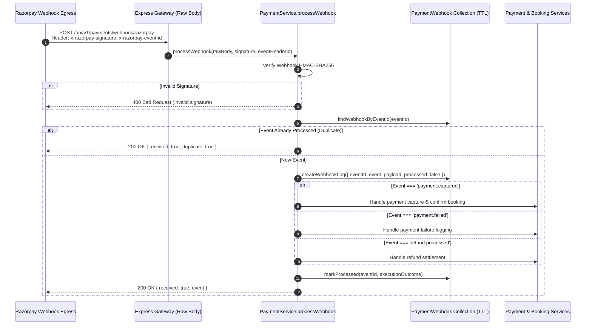

# Part 11 — Asynchronous Webhook Integration & Resiliency

## 1. Overview

While most customer payments verify synchronously through the checkout redirect (`POST /payments/verify`), edge-case network disconnects, closed browser tabs, or mobile app crashes can interrupt client callbacks.

Razorpay's asynchronous Webhook subsystem acts as the **source of ground truth**. Even if the user drops offline immediately after their bank authorizes the transaction, Razorpay delivers an authenticated HTTP webhook to `POST /api/v1/payments/webhook/razorpay`, ensuring the ticket is guaranteed to confirm.

---

## 2. Ingested Webhook Events

| Webhook Event Name | Source Payload Entity | Platform Action |
| :--- | :--- | :--- |
| `payment.captured` | `payload.payment.entity` | Confirms pending booking, updates payment to `CAPTURED`, records payment instrument details (VPA, card last4, network), emits Socket.IO event. If booking already expired, flags payment as `REFUND_REQUIRED`. |
| `payment.failed` | `payload.payment.entity` | Records gateway error code and reason, transitions payment to `FAILED`, leaves booking in pending state for customer retry until expiration. |
| `order.paid` | `payload.order.entity` | Secondary confirmation fallback; verifies order status and triggers booking confirmation if still pending. |
| `refund.processed` | `payload.refund.entity` | Verifies settlement of previously pending refund; transitions refund to `SUCCESS`; transitions booking to `REFUNDED` if balance exhausted. |
| `refund.failed` | `payload.refund.entity` | Records refund payout failure reason, sets refund to `FAILED`, logs operational alert for finance review. |

---

## 3. Webhook Handling Architecture & Idempotency

Webhooks can be retried dozens of times by Razorpay during network degradation. They can also arrive out-of-order.

---

## 4. Webhook Audit Ledger (`PaymentWebhook`)

All incoming webhook payloads are persisted in the `PaymentWebhook` collection with execution timings and error diagnostics:

- **Deduplication**: `eventId` has a unique index (`{ eventId: 1 }, { unique: true }`).
- **Storage Lifecycle**: Retained for 90 days via MongoDB TTL index (`{ createdAt: 1 }, { expireAfterSeconds: 7776000 }`), preventing database bloat while maintaining forensic audit compliance.

