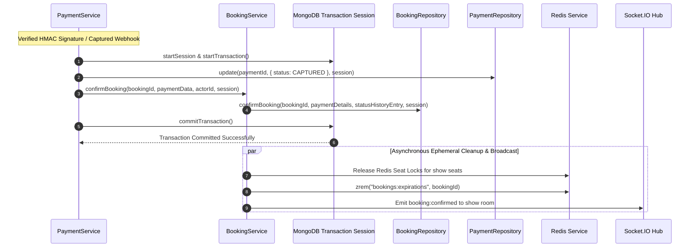

# Part 11 — Booking Confirmation & Inventory Synchronization

## 1. Overview

Confirming a movie ticket booking is an ACID-compliant transactional operation that must synchronize state across two persistent and ephemeral layers:

1. **MongoDB Durable State**:
   - Booking record transitions from `PENDING_PAYMENT` to `CONFIRMED`.
   - Payment record transitions to `CAPTURED`.
   - Payment details (amount, orderId, paymentId, capturedAt) are recorded within the booking document.
   - Compound unique index `{ showId: 1, 'seats.seatId': 1 }` locks in permanent seat ownership.
2. **Redis Ephemeral State**:
   - Temporary seat locks (`seatlock:{showId}:{seatId}`) set in Part 9 are safely cleaned up.
   - The booking reference is removed from the Redis Expiration Sorted Set (`bookings:expirations`).
3. **Real-Time WebSockets**:
   - Broadcasts `booking:confirmed` and `seat:locked` events to all connected clients viewing that auditorium.

---

## 2. Confirmation Integration Architecture



---

## 3. Atomic MongoDB Multi-Document Transaction

When a payment is captured, the update to the `Payment` document and the update to the `Booking` document execute inside a single MongoDB transaction session (`session = await mongoose.startSession()`).

If any operation fails—such as a database transient error or constraint violation—both updates are atomically aborted:
```javascript
let session = null;
if (mongoose.connection.readyState === 1) {
  try {
    session = await mongoose.startSession();
    session.startTransaction();
  } catch (_e) {
    session = null;
  }
}

try {
  await paymentRepository.update(payment._id, { status: PaymentStatus.CAPTURED, ... }, session);
  const confirmedBooking = await bookingService.confirmBooking(booking._id, paymentData, actorId, session);
  if (session) {
    await session.commitTransaction();
  }
  return { payment: updatedPayment, booking: confirmedBooking };
} catch (txErr) {
  if (session) {
    await session.abortTransaction();
  }
  throw txErr;
} finally {
  if (session) {
    session.endSession();
  }
}
```

---

## 4. Ephemeral Hold to Durable Confirmation Hand-off

During the 5-minute checkout window (Part 9 & 10), seats are held by Redis keys (`seatlock:{showId}:{seatId}`).
Once confirmed:
- The MongoDB reservation is now final and permanent.
- Ephemeral Redis locks can be immediately removed without opening a race condition, because MongoDB's compound partial index on `{ showId: 1, 'seats.seatId': 1 }` prevents any other booking from reserving those seats.
- Removing the booking from Redis `bookings:expirations` prevents the background expiration sweeper from inadvertently attempting to expire a confirmed reservation.

