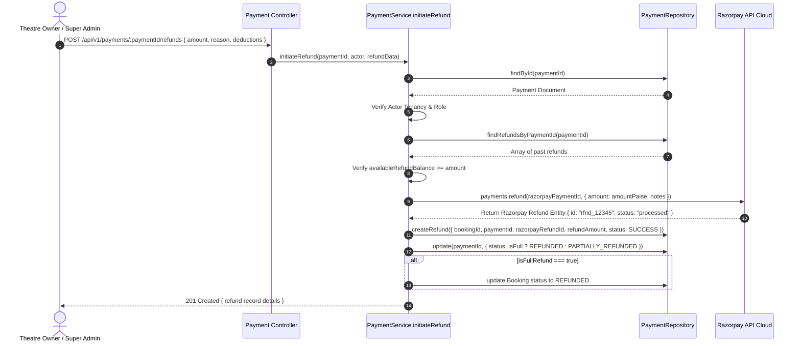

# Part 11 — Refund Management & Settlement Engine

## 1. Overview

The Refund Management module handles partial and full reversals of captured payments. Common refund triggers include:
- Customer or Box-office booking cancellations.
- Late payment captures where the reservation window expired.
- Screening cancellations by theatre partners (technical faults, power failures).
- Disputed or duplicate charges.

---

## 2. Authorization & Multi-Tenant Access Controls

Arbitrary refund generation is strictly regulated:
1. **Customer Role (`CUSTOMER`)**:
   - Customers **cannot** directly hit `POST /api/v1/payments/:paymentId/refunds`.
   - Customer cancellations must proceed through `POST /api/v1/bookings/:bookingId/cancel`, which calculates statutory cancellation fee policies and then programmatically triggers the refund pipeline.
2. **Theatre Partner Roles (`THEATRE_OWNER`, `THEATRE_MANAGER`)**:
   - Authorized to initiate refunds only for payments associated with their cinema organization (`payment.partnerId === actor.partnerId`).
   - Cross-theatre refund initiation results in a `403 Forbidden` response.
3. **Platform Super Admin (`SUPER_ADMIN`)**:
   - Global authorization to issue operational refunds across any venue or transaction.

---

## 3. Balance Calculation & Anti-Drain Invariant

Before dispatching a refund request to Razorpay, the engine computes the cumulative sum of all previously settled or pending refunds:

$$\text{capturedAmount} = \text{payment.amount}$$
$$\text{totalPreviouslyRefunded} = \sum \text{existingRefunds.refundAmount}$$
$$\text{availableRefundBalance} = \text{capturedAmount} - \text{totalPreviouslyRefunded}$$

If $\text{requestedRefundAmount} > \text{availableRefundBalance}$, the operation is rejected immediately with `400 Bad Request` (`REFUND_EXCEEDS_CAPTURED_AMOUNT`).

---

## 4. Refund Execution Flow



---

## 5. Refund Data Schema Highlights

```json
{
  "_id": "65f1a2b3c4d5e6f7a8b9c077",
  "bookingId": "65f1a2b3c4d5e6f7a8b9c099",
  "paymentId": "65f1a2b3c4d5e6f7a8b9c088",
  "customerId": "65f1a2b3c4d5e6f7a8b9c001",
  "partnerId": "65f1a2b3c4d5e6f7a8b9c0p1",
  "razorpayRefundId": "rfnd_K7B4zR5lMn9aX1",
  "grossAmount": 500,
  "deductions": 0,
  "refundAmount": 500,
  "refundAmountPaise": 50000,
  "currency": "INR",
  "reason": "CUSTOMER_CANCELLATION",
  "status": "SUCCESS",
  "initiatedBy": "65f1a2b3c4d5e6f7a8b9c011",
  "initiatedAt": "2026-10-30T10:15:00.000Z",
  "settledAt": "2026-10-30T10:15:01.000Z"
}
```

