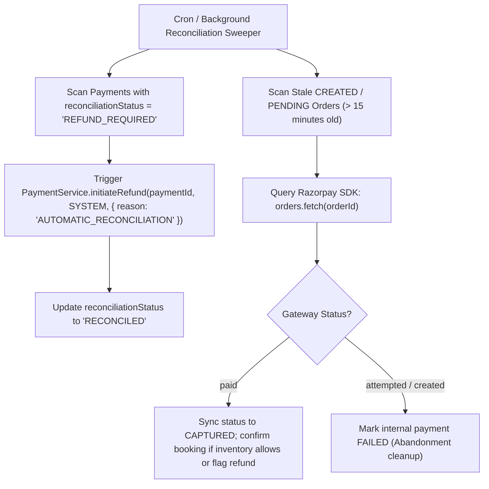

# Part 11 — Payment Reconciliation & Anomaly Detection

## 1. Overview

In high-volume payment processing, discrepancies naturally emerge due to network hiccups, delayed webhooks, bank settlement windows, and client drop-offs. The **Payment Reconciliation Engine** (`PaymentReconciliationService`) systematically scans payment and booking ledgers to identify, classify, and reconcile anomalous transactions.

---

## 2. Reconciled Anomaly Categories

| Anomaly Type | Scenario | Detection Rule | Automated Resolution |
| :--- | :--- | :--- | :--- |
| **Orphan Pending Order** | Customer generated an order but never launched checkout or abandoned modal. | `status IN ['CREATED', 'PENDING']` AND `createdAt < (now - 15 minutes)` | Check Razorpay API status. If unpaid at gateway, transition internal payment to `FAILED`. |
| **Late Capture on Expired Booking** | Customer paid at bank gateway, but webhook arrived after the 5-minute booking sweeper expired the seats. | `status === 'CAPTURED'` AND `reconciliationStatus === 'REFUND_REQUIRED'` | Automatically initiate full reverse refund via Razorpay API to restore funds to customer account. |
| **Status Drift** | Razorpay dashboard shows `captured`, but internal database remains in `PENDING`. | Razorpay order state is `paid`, internal state is `PENDING` | Fetch gateway payment details via SDK, transition payment to `CAPTURED`, confirm associated booking. |
| **Mismatched Amounts** | Client tampering or promo code synchronization issue. | `payment.amount !== booking.netPayableAmount` | Abort confirmation, mark payment as disputed / flagged for security review. |

---

## 3. Reconciliation Architecture

---

## 4. Ledger Auditing & Integrity Indexes

To support efficient indexing for reconciliation queries without slowing down transaction hot paths, compound indexes are maintained in `PaymentSchema`:

- `{ reconciliationStatus: 1, createdAt: 1 }`: Accelerated scanning of transactions flagged for refund or audit.
- `{ status: 1, createdAt: 1 }`: Accelerated scanning of stale pending transactions.
- `{ razorpayOrderId: 1 }`: Unique index providing $O(1)$ gateway order lookup.
- `{ razorpayPaymentId: 1 }`: Sparse unique index ensuring no single payment ID can be double-credited.

