# Part 11 — Payment Security, PCI-DSS & BOLA Defense

## 1. Overview

Security in financial modules demands defense-in-depth across the application boundary, network layer, data storage layer, and cryptographic operations. This document outlines the security architecture implemented in Part 11.

---

## 2. Zero PCI-DSS Footprint Architecture

The platform architecture complies with **PCI-DSS SAQ A** guidelines:

1. **No Sensitive Cardholder Data (CHD)**:
   - The platform backend **never** receives, processes, or stores raw Primary Account Numbers (PAN), credit card expiration dates, CVV / CVC security codes, or UPI MPINs.
   - All sensitive financial inputs are entered directly into Razorpay's PCI-DSS Level 1 certified hosted iframe / SDK.
2. **Sanitized Instrument Metadata Only**:
   - Only non-sensitive tokenized metadata is ingested via gateway webhooks and stored for customer receipt generation:
     - `cardLast4`: e.g., `"1111"`
     - `cardNetwork`: e.g., `"VISA"`, `"MASTERCARD"`
     - `paymentMethod`: e.g., `"upi"`, `"card"`, `"netbanking"`
     - `vpa`: e.g., `"customer@okhdfcbank"`

---

## 3. Broken Object Level Authorization (BOLA / IDOR) Defense

Payment transaction ledgers contain sensitive commercial and personal information. Multi-tenant access controls enforce strict scoping:

### Customer Scoping
When a customer requests `GET /api/v1/payments/:paymentId`:
```javascript
if (actor.role === Roles.CUSTOMER) {
  if (payment.customerId.toString() !== actor.id.toString()) {
    // Return 404 NOT_FOUND instead of 403 to prevent resource enumeration
    throw new AppError('Payment not found under your account', HttpStatus.NOT_FOUND, ErrorCodes.PAYMENT_NOT_FOUND);
  }
}
```
*Rationale*: Returning `404 Not Found` prevents unauthorized users from probing valid payment ObjectIds.

### Theatre Partner Scoping
When a theatre owner requests payment details or initiates a refund:
```javascript
if (actor.role === Roles.THEATRE_OWNER || actor.role === Roles.THEATRE_MANAGER) {
  if (payment.partnerId.toString() !== actor.partnerId?.toString()) {
    throw new AppError('Payment not found under your cinema organization', HttpStatus.NOT_FOUND, ErrorCodes.PAYMENT_NOT_FOUND);
  }
}
```

---

## 4. Cryptographic Integrity Protections

| Threat | Vulnerability Vector | Defense Implementation |
| :--- | :--- | :--- |
| **Signature Forgery** | Attacker calls `/payments/verify` with fabricated payment IDs. | Server-side HMAC-SHA256 signature verification over `orderId + '|' + paymentId`. |
| **Timing Attacks** | Attacker measures nanosecond differences in HMAC verification strings. | `crypto.timingSafeEqual` over fixed-length UTF-8 buffers. |
| **Payload Tampering** | Attacker intercepts webhook HTTP post and changes captured amount. | Raw-body HMAC verification against Razorpay webhook signing secret. |
| **Replay Attacks** | Attacker replays genuine webhook captured payloads repeatedly. | Unique index on `eventId` in `PaymentWebhook` collection. |
| **Double Refund Attack** | Rapid concurrent refund requests drain payment balance. | Server-side atomic balance validation and pessimistic transition checks. |

---

## 5. Defense-in-Depth Summary

```mermaid
flowchart LR
    subgraph Edge ["Edge & Transport"]
        TLS["TLS 1.3 / HTTPS"]
        Helmet["Helmet Security Headers"]
        RateLimit["Express Rate Limiter"]
    end
    
    subgraph AuthLayer ["Authentication & Access"]
        JWT["JWT Auth Middleware"]
        RBAC["Role-Based Access Control"]
        BOLA["Partner & Customer Scoping"]
    end
    
    subgraph CryptoLayer ["Cryptographic Guard"]
        HMAC["HMAC-SHA256 Verification"]
        TimingSafe["crypto.timingSafeEqual"]
    end
    
    subgraph PersistenceLayer ["Persistent Storage"]
        NoCHD["No Card/CVV Storage"]
        TTL["90-day TTL Webhook Log"]
    end

    Edge --> AuthLayer --> CryptoLayer --> PersistenceLayer
```



