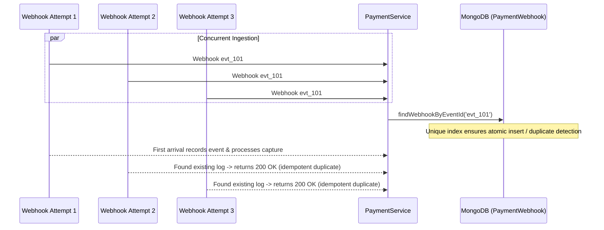

# Part 11 — Payment Concurrency, Race Conditions & Idempotency

## 1. Overview

In high-concurrency movie ticketing (such as blockbuster opening sales), payment systems experience severe race conditions: duplicate webhooks, concurrent client redirects vs webhooks, simultaneous refund requests, and race conditions between payment captures and seat expiration sweepers.

This document examines how Part 11 guarantees absolute consistency across these race conditions.

---

## 2. Race Condition 1: Duplicate Webhook Delivery

**Scenario**: Razorpay retries webhook delivery due to slow upstream acknowledgment, sending the identical `payment.captured` event 3 times within 50 milliseconds.



**Resolution Invariant**:
- Deduplication via unique `eventId` indexing.
- Subsequent duplicate webhooks immediately return `200 OK { received: true, duplicate: true }` without touching booking or payment states.

---

## 3. Race Condition 2: Simultaneous Webhook & Frontend Verification

**Scenario**: The customer finishes payment in the browser, which immediately calls `POST /payments/verify`. Simultaneously, Razorpay's background infrastructure fires the `payment.captured` webhook. Both arrive within 5ms of each other.

**Resolution Invariant**:
- Both paths check the existing state of `Payment` and `Booking`:
  ```javascript
  if (payment.status === PaymentStatus.CAPTURED && booking.status === BookingStatus.CONFIRMED) {
    logger.info({ paymentId: payment._id, bookingId: booking._id }, 'Payment and booking already confirmed; returning idempotent success');
    return { payment, booking };
  }
  ```
- Whichever transaction completes the MongoDB atomic commit first wins. The second arrival recognizes the `CONFIRMED` state and safely returns an idempotent success response without duplicating database writes or WebSocket broadcasts.

---

## 4. Race Condition 3: Payment Capture vs Booking Expiration Sweeper

**Scenario**: A customer authorizes their bank OTP at second 299 of a 300-second booking hold. At second 300, the background expiration worker fires, marking the booking `EXPIRED` and clearing Redis locks. At second 301, the bank capture arrives.

**Risk**: If unhandled, the customer loses money without receiving tickets, or the system double-books the seats if another user grabbed them at second 300.5.

**Resolution Invariant**:
```mermaid
flowchart TD
    CaptureArrival["Capture Arrives (Verify / Webhook)"]
    --> CheckBooking["Inspect booking.status"]
    --> ExpiredBranch{"Is booking EXPIRED?"}
    
    ExpiredBranch -->|Yes| RecordDeduction["Mark Payment CAPTURED"]
    RecordDeduction --> FlagRefund["Set reconciliationStatus = 'REFUND_REQUIRED'"]
    FlagRefund --> AuditNote["Append Status History: 'Marked REFUND_REQUIRED due to late arrival'"]
    FlagRefund --> AutoRefundQueue["Queue full automatic reverse refund"]
    FlagRefund --> ReturnError["Return 409 Conflict with friendly message"]

    ExpiredBranch -->|No (PENDING_PAYMENT)| ConfirmNormally["Confirm Booking Normally"]
```

---

## 5. Race Condition 4: Concurrent Duplicate Refunds

**Scenario**: An administrator accidentally clicks "Refund" twice, or two scripts fire concurrent refund requests for the same transaction.

**Resolution Invariant**:
- The service retrieves all existing refunds for that payment and computes the unrefunded balance before calling the gateway.
- If cumulative refunds exceed the captured amount, the second request is immediately rejected (`REFUND_EXCEEDS_CAPTURED_AMOUNT`).
- Razorpay itself enforces an idempotency key on refund calls, rejecting duplicate refund attempts at the gateway layer.

