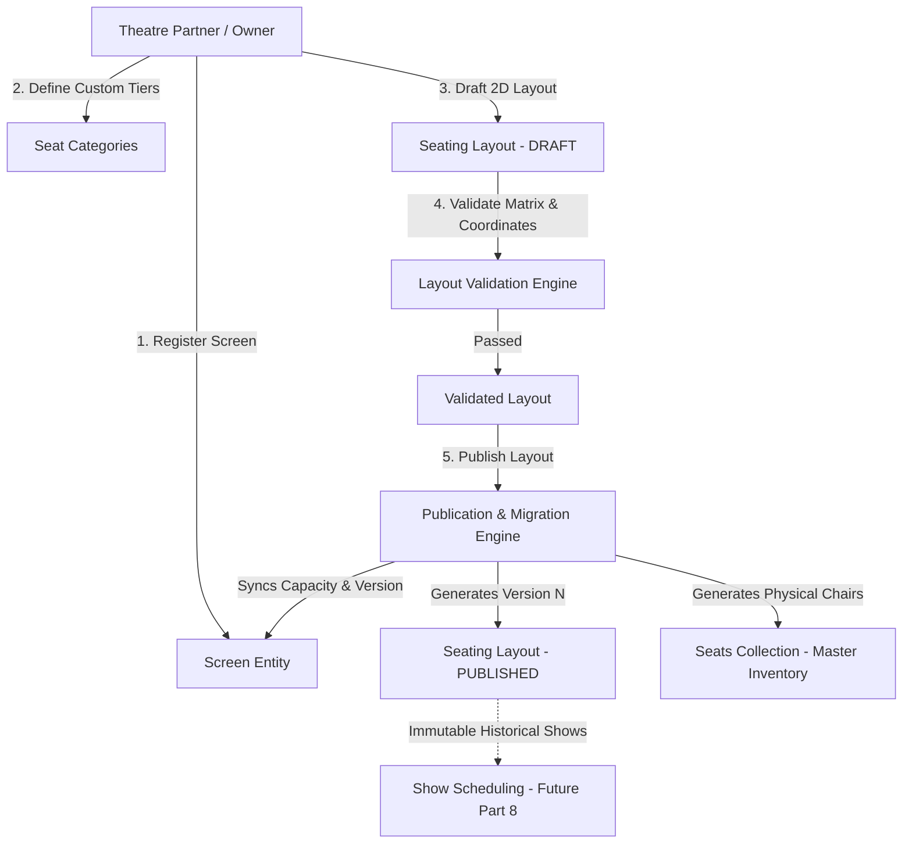

# Screen & Seat Layout Management Overview

## 1. Executive Summary
The **Screen & Seat Layout Management Module** constitutes the foundational spatial and structural layer of the BookMyShow Clone platform. It bridges physical cinema auditoriums with real-time seat inventory, dynamic pricing tiers, visual layout editors, and immutable historical reservation auditing.

Every screen in our platform represents an auditorium within a multi-screen multiplex or single-screen theatre. Each screen features:
- Core physical specifications (supported projection formats, audio sound systems, operational status).
- Dynamic, tenant-customizable seat tier categories (Standard, Executive, Prime VIP Recliners, Wheelchair bays).
- An SVG/canvas-ready 2D matrix grid accommodating irregular rows, gaps, walking aisles, and non-rectangular geometries.
- An **immutable layout versioning engine**, ensuring that auditorium renovations, reseating, or capacity adjustments never corrupt historical showtimes or purchased tickets.

---

## 2. Key Architecture Pillars

### Core Responsibilities
1. **Auditorium Management**: Lifecycle state machine (`ACTIVE`, `INACTIVE`, `MAINTENANCE`, `UNDER_CONSTRUCTION`), technology specs (`STANDARD`, `IMAX`, `DOLBY_ATMOS`, `4DX`), audio configurations (`Dolby 7.1`, `Dolby Atmos 12.1`).
2. **Seat Category Hierarchy**: Global system default tiers paired with tenant-level custom pricing categories, hex display codes, and baseline price tags.
3. **Layout Builder Engine**: Draft layout creation, bulk algorithmic grid generation, coordinate collision detection, and instant capacity calculation.
4. **Non-Destructive Versioning**: Complete snapshotting of seat matrices upon publication; past shows maintain permanent links to their specific layout version.
5. **Physical Seat Inventory**: Production `seats` collection storing physical chair records indexed by `{ screenId, layoutVersion, seatLabel }` and `{ screenId, layoutVersion, gridRow, gridCol }`.
6. **Multi-Tenant SaaS Boundary**: Strict tenant scoping preventing unauthorized theatre owners from discovering or tampering with competing screens or layouts (BOLA/IDOR protection).

