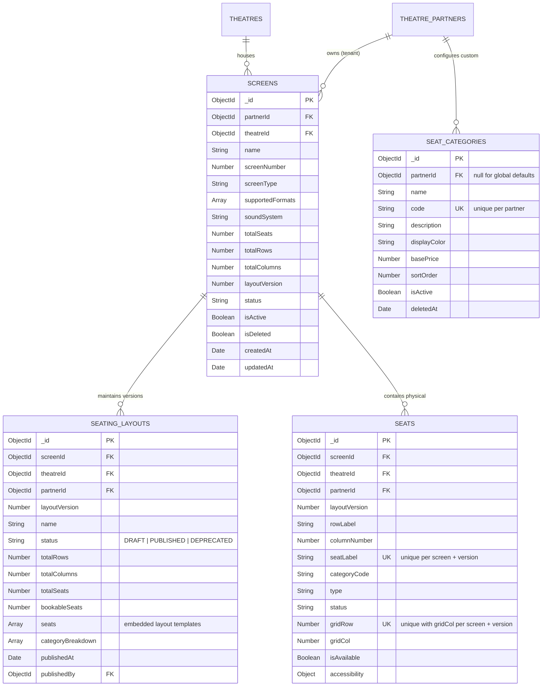

# Screen & Seat Layout Database Design

## 1. Entity-Relationship Overview

---

## 2. Collections and Indexes

### 2.1 Collection: `screens`
| Field | Type | Required | Description |
|---|---|---|---|
| `_id` | ObjectId | Yes | Unique Screen identifier |
| `partnerId` | ObjectId | Yes | Ref: `theatre_partners` (Multi-tenant partition key) |
| `theatreId` | ObjectId | Yes | Ref: `theatres` |
| `name` | String | Yes | Screen display name (e.g., "Screen 1 - IMAX Laser") |
| `screenNumber` | Number | Yes | Positive integer unique within theatre |
| `screenType` | String | Yes | Enum: `STANDARD`, `IMAX`, `DOLBY_ATMOS`, `4DX`, `PREMIUM`, `OTHER` |
| `supportedFormats` | [String] | Yes | `['2D', '3D', 'IMAX_2D', 'IMAX_3D', '4DX']` |
| `soundSystem` | String | No | e.g. "Dolby Atmos 12.1", "Dolby 7.1" |
| `totalSeats` | Number | Yes | Synced physical seat capacity from latest published layout |
| `layoutVersion` | Number | Yes | Active published layout version number (defaults to 1) |
| `status` | String | Yes | Enum: `ACTIVE`, `INACTIVE`, `MAINTENANCE`, `UNDER_CONSTRUCTION` |

#### Compound Indexes
- `{ theatreId: 1, screenNumber: 1, deletedAt: 1 }` (Unique): Prevents duplicate screen numbers within the same theatre auditorium inventory.
- `{ partnerId: 1, theatreId: 1, isActive: 1 }`: Accelerated query lookups for theatre owner dashboards.
- `{ theatreId: 1, isActive: 1, isDeleted: 1 }`: Accelerated lookups for customer show scheduling and availability.

---

### 2.2 Collection: `seat_categories`
| Field | Type | Description |
|---|---|---|
| `_id` | ObjectId | Primary Key |
| `partnerId` | ObjectId | Null for system-wide defaults; Populated for tenant custom tiers |
| `name` | String | Display name (e.g. "VIP Recliner", "Executive Premium") |
| `code` | String | Uppercase alphanumeric code (e.g. `RECLINER`, `REGULAR`) |
| `displayColor` | String | Hex color string for interactive UI rendering (e.g. `#8B5CF6`) |
| `basePrice` | Number | Baseline pricing guideline in currency units |
| `sortOrder` | Number | Visual hierarchy ordering |
| `isActive` | Boolean | Operational flag |

#### Compound Indexes
- `{ partnerId: 1, code: 1, deletedAt: 1 }` (Unique): Prevents duplicate category codes within an organization.
- `{ isActive: 1, sortOrder: 1 }`: Fast ordering in category pickers.

---

### 2.3 Collection: `seating_layouts`
Stores full visual matrices for draft editing and published snapshots.

#### Compound Indexes
- `{ screenId: 1, layoutVersion: 1 }` (Unique): Enforces immutable versioning snapshots.
- `{ screenId: 1, status: 1 }`: Fast retrieval of active DRAFT or PUBLISHED layout.

---

### 2.4 Collection: `seats`
The master physical chairs table. Represents physical items available to be instantiated into show seat instances during show scheduling.

#### Compound Unique Constraints
- `{ screenId: 1, layoutVersion: 1, seatLabel: 1 }` (Unique): **Critical Invariant**. Guarantees that within a layout version, no two seats can share identical labels (e.g., duplicate 'A1').
- `{ screenId: 1, layoutVersion: 1, gridRow: 1, gridCol: 1 }` (Unique): **Spatial Invariant**. Guarantees that two physical chairs cannot occupy identical 2D coordinates on the canvas.
- `{ screenId: 1, layoutVersion: 1, isAvailable: 1 }`: Fast filtering of bookable seats during show inventory creation.

