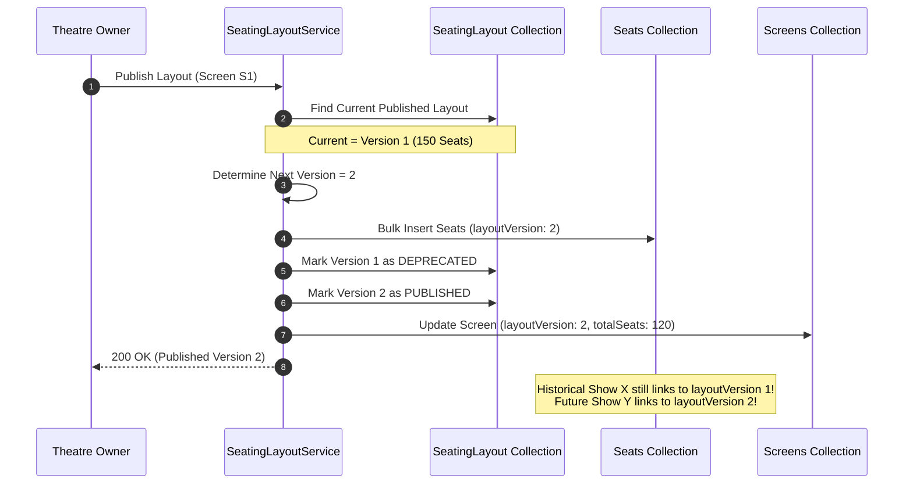
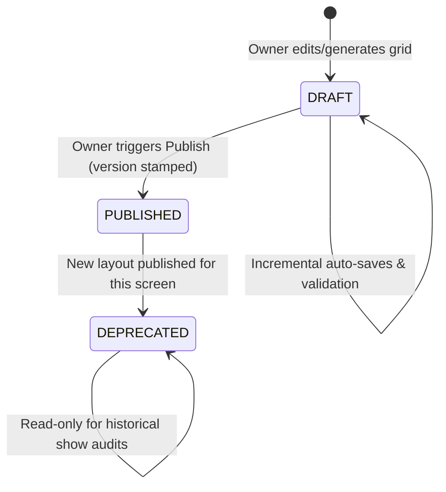

# Immutable Layout Versioning Architecture

## 1. Problem Statement: The Auditorium Renovation Dilemma
In high-volume movie ticketing systems, cinemas frequently alter auditoriums:
- Recliner installations (reducing 250 standard chairs to 120 VIP recliners).
- Temporary physical seat blocking for VIP events, sound consoles, or technical maintenance.
- Emergency aisle modifications.

**Naive Anti-Pattern**: Mutating existing seat records in-place.
- **Catastrophic Impact**: If an auditorium's layout is mutated in-place, historical bookings for past shows now reference deleted or repositioned seats. Customer tickets for "Seat C12" point to empty aisles, financial audit reports fail, and refund calculations become corrupt.

---

## 2. Immutable Versioning Solution

Our architecture treats each published seating layout as an **immutable snapshot**:



---

## 3. Version Lifecycle States



1. **`DRAFT`**: Working buffer. Can be freely edited, regenerated, tested, and previewed without affecting active shows or tickets.
2. **`PUBLISHED`**: Active blueprint for all newly scheduled shows. Exactly one layout per screen has `status: 'PUBLISHED'` at any time.
3. **`DEPRECATED`**: Historical blueprint. Retained indefinitely for past show lookups, customer booking history, and accounting reconciliations.

---

## 4. Database-Level Isolation
In the `seats` collection, physical chairs carry `layoutVersion`:
```javascript
{
  screenId: ObjectId("65f1a2b3c4d5e6f7a8b9c0e1"),
  layoutVersion: 2, // Explicit version scope
  seatLabel: "A1",
  gridRow: 0,
  gridCol: 0
}
```
Compound unique indexes include `layoutVersion`:
- `{ screenId: 1, layoutVersion: 1, seatLabel: 1 }` (Unique)
- `{ screenId: 1, layoutVersion: 1, gridRow: 1, gridCol: 1 }` (Unique)

This allows Version 2 to have completely different row counts, labels, and coordinates without colliding with Version 1.

