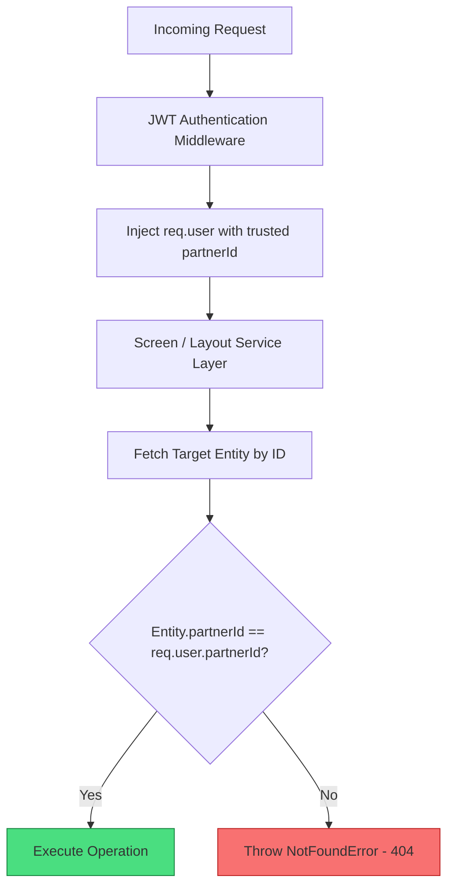

# Multi-Tenant Security & BOLA Protection

## 1. Threat Model & BOLA Vulnerabilities
In multi-tenant SaaS ticketing systems, Broken Object Level Authorization (OWASP API1:2023 - BOLA), also known as Insecure Direct Object References (IDOR), is the primary attack vector against cinema partners.

### Attack Scenarios Mitigated:
1. **Auditorium Enumeration**: Cinema Chain A guessing Screen IDs belonging to Cinema Chain B to monitor auditorium sizes and formats.
2. **Layout Tampering**: Cinema Chain A modifying or corrupting seating layouts of competitor Cinema Chain B.
3. **Ghost Screen Injection**: Cinema Chain A sending `POST /owner/theatres/:theatreId/screens` using Cinema Chain B's `theatreId`.
4. **Physical Seat Manipulation**: Directly updating seat status (`BLOCKED`, `MAINTENANCE`) on a competitor's screen via IDOR.

---

## 2. Defence-in-Depth Enforcement

### 1. Trusted Tenant Context
The `partnerId` is **never accepted from query parameters or request payloads**. It is exclusively extracted from the cryptographic JWT access token verified against the database session store.

### 2. Anti-Enumeration Principle (Return 404, Not 403)
When an unauthorized tenant attempts to view, modify, or delete a resource belonging to another tenant:
- Returning `403 Forbidden` confirms to the attacker that the resource ID exists.
- The platform strictly throws `NotFoundError('Screen not found', ErrorCodes.SCREEN_NOT_FOUND)`, returning `404 Not Found`. The attacker receives no hint about whether the ID belongs to another tenant or is completely non-existent.

### 3. Cascading Authorization Checks
- **Screen Creation**: Verifies that `parentTheatre.partnerId === userContext.partnerId`.
- **Layout Publication**: Verifies that `screen.partnerId === userContext.partnerId` AND `seatCategory.partnerId` is either `null` or matches `userContext.partnerId`.
- **Physical Seat Querying & Updates**: Scoped strictly to `partnerId`.

---

## 3. Automated Verification
Multi-tenant isolation and BOLA protection are continuously asserted via automated integration tests in:
`apps/backend/tests/integration/screen-owner-isolation.test.js`
Verifying 100% rejection across screens, theatres, categories, layouts, and seats.

