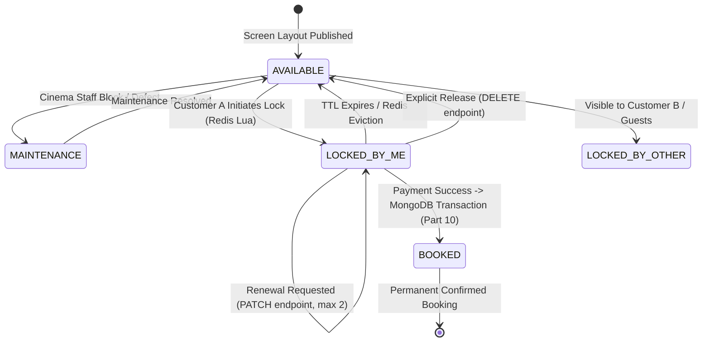

# Part 9 — Seat Availability & Temporary Seat Locking: Overview

## 1. Executive Summary

In a high-scale movie ticketing platform like BookMyShow, seat selection represents the most concurrency-intensive transaction point in the entire user journey. During blockbuster releases or high-demand screening windows, hundreds or thousands of prospective patrons concurrently view the same auditorium layout and attempt to reserve identical prime seats simultaneously.

The **Seat Availability and Temporary Seat Locking System** serves as the distributed concurrency barrier that bridges browsing customers with transactional payment processing. It provides:
1. **Real-time Seating Topology & Availability**: Rendering accurate visual audit maps composed of physical auditoriums, seating layouts, maintenance states, confirmed bookings, and live ephemeral holds.
2. **Deterministic Race-Condition Elimination**: Guaranteeing zero double-locking and zero double-booking via atomic multi-key Lua scripts executed on Redis.
3. **Optimistic In-Flight Reservations**: Granting authenticated customers a strict, time-bounded exclusive reservation window (default 300 seconds / 5 minutes) to finalize ticket purchase.
4. **Instant Multi-Client Synchronization**: Broadcasting granular seat state transitions over low-latency WebSocket rooms powered by Socket.IO and clustered Redis Pub/Sub adapters.

---

## 2. Core Business Requirements

| Requirement | Specification | Enforcement Mechanism |
| :--- | :--- | :--- |
| **Max Seats Per Lock** | 10 seats per booking transaction | Controller & Zod validation schema + Redis Lua verification |
| **Default Lock TTL** | 300 seconds (5 minutes) | Redis key TTL (`EXPIRE`) + ISO expiration timestamp |
| **Lock Renewal Limit** | Maximum 2 renewals (300s each) | Lua script tracking `renewalCount < maxRenewals` |
| **Atomicity Guarantee** | All-or-nothing multi-seat lock | Redis single-threaded Lua script with pre-check phase |
| **Ownership Isolation** | Strict BOLA / IDOR protection | Cryptographic UUIDv4 `lockId` + JWT `userId` validation |
| **Multi-Tier Reconciliation** | Tri-layer availability calculation | Physical Screen DB -> Confirmed Bookings DB -> Redis Locks |
| **Guest / User Privacy** | Zero PII or Token Leakage | Anonymized WebSocket broadcasts; `LOCKED_BY_ME` calculated per client |
| **Real-time Push** | Sub-50ms seat state updates | Socket.IO room `show:{showId}` + Redis Pub/Sub multi-node broadcast |

---

## 3. High-Level User Journey & Seat Lifecycle

### User Interaction Phases:
1. **Show Discovery & Layout Inspection**:
   - The customer navigates to the showtime page. The frontend requests `GET /api/v1/shows/:showId/seats`.
   - The backend retrieves the published physical screen layout, queries durable confirmed bookings from MongoDB, inspects active in-flight locks in Redis, and synthesizes a unified row-by-row layout.
   - If authenticated, the customer's own active holds are marked `LOCKED_BY_ME` with remaining lock countdown seconds, while other customers' holds appear as `LOCKED_BY_OTHER`. Unauthenticated visitors see `LOCKED_BY_OTHER` for all held seats.
2. **Room Subscription**:
   - The client establishes a Socket.IO connection and emits `join:show` with `showId`.
   - The server joins the socket to room `show:{showId}`.
3. **Atomic Multi-Seat Selection & Hold**:
   - Customer selects up to 10 seats and clicks "Proceed to Checkout".
   - Client sends `POST /api/v1/shows/:showId/seat-locks` with `seatIds: ["..."]` and optional `x-idempotency-key`.
   - The server validates show bookability, physical seat validity, and absence of confirmed bookings.
   - An atomic Redis Lua script executes. If all seats are unheld, all keys are created atomically with TTL.
   - Server returns HTTP 201 Created with `lockId`, `expiresAt`, and `ttlSeconds`.
   - A Socket.IO `seat:locked` event is broadcast to the entire room, immediately disabling those seats on all other patrons' browsers.
4. **Checkout or Cancellation**:
   - If the customer abandons checkout, they click cancel or navigate away: client calls `DELETE /api/v1/shows/:showId/seat-locks`. The Lua script safely deletes the hold, and `seat:released` is broadcast.
   - If the customer needs more time to complete payment, they call `PATCH /api/v1/shows/:showId/seat-locks/renew`.
   - If the customer completes payment (Part 10), MongoDB commits the confirmed booking inside a ACID transaction, and the lock is converted to permanent `BOOKED` state.

---

## 4. Key Architectural Decisions

1. **Redis as Ephemeral Concurrency Tier**:
   - Using relational or document databases for rapid short-lived lock acquisition creates significant write-amplification, index bloat, and transactional lock contention under spike traffic.
   - Storing ephemeral locks in memory with native Redis TTL offloads peak locking traffic entirely from primary MongoDB clusters.
2. **Single-Threaded Lua Scripts for Zero-Race-Condition Guarantees**:
   - Multi-seat locking requires atomic verification of $N$ keys. Standard Redis multi-exec blocks cannot execute conditional checks based on read values without `WATCH`, which suffers from high abort rates under heavy contention.
   - Lua scripts run atomically in Redis's single execution thread, providing 100% deterministic evaluation without race conditions.
3. **Dual Identifier Ownership Verification**:
   - Every lock payload retains both a client-scoped `lockId` (UUIDv4) and the authenticated `userId`.
   - Release and renewal operations enforce that both IDs match the stored Redis hash, defeating Broken Object Level Authorization (BOLA/IDOR) exploits.
4. **Zero-PII WebSocket Broadcasts**:
   - Real-time room events broadcast only `{ showId, seatIds: [...] }`. No customer names, user IDs, or lock tokens are transmitted over WebSocket channels, preventing user profiling or token interception by third-party spectators.

