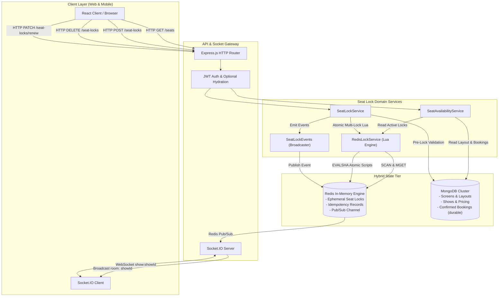

# Part 9 — Seat Locking Architecture

## 1. Architectural Overview & System Topology

The seat locking architecture separates ephemeral real-time state from persistent transactional state to achieve sub-millisecond locking latency and zero read-write contention on primary database clusters during high-concurrency ticket rushes.



---

## 2. Separation of Concerns: Redis vs MongoDB

| Concern | Redis (In-Memory Concurrency Tier) | MongoDB (Durable System of Record) |
| :--- | :--- | :--- |
| **Data Scope** | In-flight temporary holds (300 seconds TTL), idempotency markers (600s TTL). | Master screen definitions, published layouts, shows, dynamic pricing, and confirmed tickets. |
| **Write Latency** | Sub-millisecond (0.1ms – 0.5ms) via single-threaded in-memory execution. | 5ms – 25ms with replica set journal durability write concerns (`w: "majority"`). |
| **Concurrency Control** | Redis Lua scripting (`ACQUIRE_MULTI_SEAT_LOCKS_LUA`), single-threaded non-blocking queue. | Multi-document ACID transactions with document-level locking and MVCC. |
| **Lifecycle** | Self-evicting via Redis key expiration (`EXPIRE`). Zero cron or disk cleanup required. | Permanent audit record, queryable financial logs, customer tickets. |
| **Failure Recovery** | Keyspace loss causes temporary holds to be released; clients safely re-lock. Durable bookings unaffected. | Replicated with majority write concern; zero data loss guaranteed. |

---

## 3. Data Flow Workflows

### 3.1 Seat Availability Query (`GET /shows/:showId/seats`)
1. **Show Validation**: Verify that the requested show exists and is in `PUBLISHED` status.
2. **Layout Retrieval**: Fetch the published screen layout corresponding to the show's `screenId` and `layoutVersion`.
3. **Physical Seat Indexing**: Query all active physical seats from `seats` collection matching `screenId` and `layoutVersion`.
4. **Confirmed Bookings Query**: Query MongoDB `bookings` collection for confirmed records matching `showId` where `status IN ('CONFIRMED', 'COMPLETED')`. Extract all booked seat IDs into a `Set`.
5. **Ephemeral Locks Retrieval**: Query Redis via non-blocking `SCAN` iteration for keys matching pattern `seatlock:{showId}:*`. Execute batch `MGET` to retrieve lock metadata payloads.
6. **Multi-Tier Merging**:
   - For each physical seat:
     - If physical status is `MAINTENANCE` $\rightarrow$ seat is `MAINTENANCE`.
     - Else if seat ID exists in confirmed bookings $\rightarrow$ seat is `BOOKED`.
     - Else if active Redis lock exists:
       - If `req.user.id == lock.userId` $\rightarrow$ seat is `LOCKED_BY_ME` with remaining lock seconds.
       - Else $\rightarrow$ seat is `LOCKED_BY_OTHER`.
     - Else $\rightarrow$ seat is `AVAILABLE`.
7. **Response Formatting**: Group seats by row, attach pricing tiers from show pricing, calculate real-time inventory statistics, and return standard API envelope.

---

### 3.2 Atomic Seat Locking (`POST /shows/:showId/seat-locks`)
1. **Authentication Check**: Verify customer JWT access token.
2. **Payload Validation**: Zod schema verifies `seatIds` array (1 to 10 valid ObjectIds) and deduplicates input.
3. **Idempotency Guard**: If `x-idempotency-key` header is present, check Redis for existing cached result. If found, return cached response immediately.
4. **Show & Layout Validation**:
   - Verify show exists and status is `PUBLISHED`.
   - Verify all requested `seatIds` belong to the show's assigned screen and `layoutVersion`.
   - Verify none of the requested seats are marked `MAINTENANCE` or `INACTIVE`.
5. **MongoDB Confirmed Booking Check**:
   - Query MongoDB `bookings` for any confirmed bookings for this show containing any of the requested seats.
   - If any seat is already booked, throw `409 ConflictError (SEAT_UNAVAILABLE)`.
6. **Redis Lua Execution**:
   - Construct Redis keys for each seat: `seatlock:{showId}:{seatId}`.
   - Execute `ACQUIRE_MULTI_SEAT_LOCKS_LUA` with arguments: `[keys...]`, `[lockId, userId, ttlSeconds, lockDataJson]`.
   - The script inspects all keys. If any key exists, it aborts immediately with code `SEAT_ALREADY_LOCKED`.
   - If all keys are absent, it writes each key with `PSETEX` and records user lock tracking set.
7. **Idempotency Persistence**: If idempotency key was supplied, store the lock result in Redis with a 600-second TTL.
8. **Real-time Event Broadcast**:
   - Emit `seat:locked` event via `SeatLockEvents.notifySeatsLocked` to Socket.IO room `show:{showId}`.
   - Redis Pub/Sub distributes the event across all horizontally scaled application nodes.
9. **Return Envelope**: Return HTTP 201 Created with `lockId`, `lockedSeats`, `expiresAt`, `ttlSeconds`, and `maxRenewals`.

---

### 3.3 Safe Seat Lock Release (`DELETE /shows/:showId/seat-locks`)
1. **Authentication Check**: Authenticate customer.
2. **Payload Validation**: Verify `lockId` (UUID) and `seatIds` (array of ObjectIds).
3. **Redis Lua Safe Release**:
   - Execute `RELEASE_MULTI_SEAT_LOCKS_LUA` with arguments: `[keys...]`, `lockId`, `userId`.
   - For each key, the script verifies:
     ```lua
     if redis.call('exists', key) == 1 then
       local data = cjson.decode(redis.call('get', key))
       if data.lockId == expectedLockId and data.userId == expectedUserId then
         redis.call('del', key)
       end
     end
     ```
   - This prevents race conditions where an expired lock that was re-acquired by User B could be erroneously released by an old request from User A.
4. **Real-time Broadcast**: Emit `seat:released` event to room `show:{showId}`.
5. **Return Envelope**: Return HTTP 200 OK.

