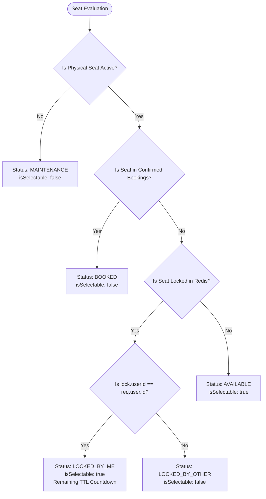

# Part 9 — Seat Availability Reconciliation Engine

## 1. Multi-Tier Reconciliation Architecture

Seat availability is not a simple database column; it is a computed real-time synthesis derived from three distinct layers of state:

```
┌─────────────────────────────────────────────────────────────────────────────┐
│                       MULTI-TIER RECONCILIATION ENGINE                      │
├───────────────────┬──────────────────────────────────┬──────────────────────┤
│ LAYER             │ SOURCE DATA                      │ STATUS IMPACT        │
├───────────────────┼──────────────────────────────────┼──────────────────────┤
│ 1. Physical Screen│ Screen layout & Seat records     │ INACTIVE, MAINTENANCE│
├───────────────────┼──────────────────────────────────┼──────────────────────┤
│ 2. Durable Sales  │ MongoDB Confirmed Bookings       │ BOOKED               │
├───────────────────┼──────────────────────────────────┼──────────────────────┤
│ 3. Ephemeral Holds│ Redis Distributed Key-Value Store│ LOCKED_BY_ME / OTHER │
└───────────────────┴──────────────────────────────────┴──────────────────────┘
```

---

## 2. Status Priority & Evaluation Pipeline

When `SeatAvailabilityService.getSeatAvailability(showId, userId)` evaluates each seat in the screen grid, it applies strict precedence rules:



---

## 3. Real-Time Pricing Attachment

Each seat in the grid is mapped to its corresponding category pricing configured for the specific show (`ShowPricing`):
1. The show's `pricingTiers` array is loaded and indexed into a fast lookup `Map<categoryCode, pricingTier>`.
2. As each seat is processed:
   - `price`: Effective price inclusive of tax and fees (e.g. `531.00`).
   - `basePrice`: Base ticket price (e.g. `450.00`).
   - `categoryCode`: E.g. `RECLINER`, `PRIME`, `CLASSIC`.

---

## 4. Aggregate Inventory Metrics

The reconciliation engine calculates comprehensive capacity statistics returned in the API summary envelope:
- `totalPhysicalSeats`: Total active seats defined in the screen layout.
- `availableSeats`: Total seats unbooked, unheld, and unblocked.
- `lockedSeats`: Total seats held under temporary Redis locks.
- `bookedSeats`: Total seats permanently sold in confirmed MongoDB bookings.
- `maintenanceSeats`: Total physical seats marked defective or blocked by cinema management.
- `occupancyRate`: `(bookedSeats + lockedSeats) / totalPhysicalSeats * 100`.

---

## 5. Performance Optimizations

1. **Lean Database Projections**:
   - `seats.find({ screenId, layoutVersion, status: 'ACTIVE' })` selects only structural coordinate fields (`rowLabel`, `columnNumber`, `seatLabel`, `categoryCode`, `type`).
   - `bookings.find({ showId, status: { $in: [...] } })` uses lean projection `select('seats.seatId')`.
2. **In-Memory Set Lookups**:
   - Confirmed bookings seat IDs are collected into a `Set<string>`, enabling $O(1)$ membership checks during grid assembly.
3. **Pipelined Redis Lookups**:
   - Non-blocking `SCAN` iteration + batch `MGET` fetches all active locks for the show in a single Redis roundtrip.
4. **Sub-15ms Target Latency**:
   - The entire reconciliation pipeline completes in under 15ms for an 800-seat auditorium.

