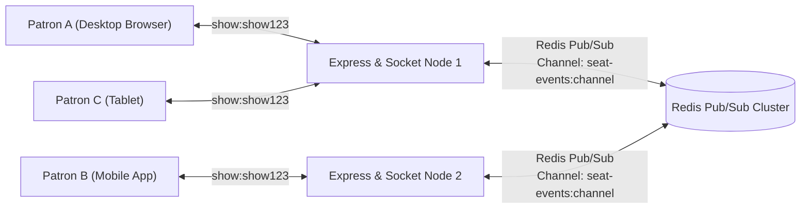

# Part 9 — Socket.IO Real-Time Seat Events & Multi-Instance Scaling

## 1. Overview & Room Architecture

In an interactive ticket booking interface, changes in seat availability must be pushed immediately to all connected browsers viewing the same show layout. Polling every second introduces severe database load and noticeable UI lag.

Socket.IO provides bi-directional event transport, organizing clients into isolated show-specific rooms:
- **Room Key Format**: `show:{showId}`
- **Isolation Guarantee**: Clients viewing *Show A* receive only *Show A* updates, with zero cross-talk or overhead from *Show B*.



---

## 2. Event Catalog & Payload Specifications

All events emitted to the room carry zero personally identifiable information (PII).

### 2.1 Event: `seat:locked`
Emitted immediately after a customer successfully locks seats via `POST /api/v1/shows/:showId/seat-locks`.
```json
{
  "event": "seat:locked",
  "data": {
    "showId": "67220b3f81e7d23a104f9b01",
    "seatIds": [
      "65f1a2b3c4d5e6f7a8b9c0f3",
      "65f1a2b3c4d5e6f7a8b9c0f4"
    ],
    "expiresAt": "2026-11-06T19:05:00.000Z",
    "timestamp": "2026-11-06T19:00:00.000Z"
  }
}
```

### 2.2 Event: `seat:released`
Emitted when a customer cancels their booking flow or releases seats via `DELETE /api/v1/shows/:showId/seat-locks`.
```json
{
  "event": "seat:released",
  "data": {
    "showId": "67220b3f81e7d23a104f9b01",
    "seatIds": [
      "65f1a2b3c4d5e6f7a8b9c0f3"
    ],
    "timestamp": "2026-11-06T19:02:15.000Z"
  }
}
```

### 2.3 Event: `seat:expired`
Emitted when temporary holds naturally lapse due to Redis TTL expiration without payment completion.
```json
{
  "event": "seat:expired",
  "data": {
    "showId": "67220b3f81e7d23a104f9b01",
    "seatIds": [
      "65f1a2b3c4d5e6f7a8b9c0f3"
    ],
    "timestamp": "2026-11-06T19:05:01.000Z"
  }
}
```

### 2.4 Event: `seat:booked`
Emitted upon payment gateway success and confirmed MongoDB booking creation (Part 10).
```json
{
  "event": "seat:booked",
  "data": {
    "showId": "67220b3f81e7d23a104f9b01",
    "seatIds": [
      "65f1a2b3c4d5e6f7a8b9c0f3",
      "65f1a2b3c4d5e6f7a8b9c0f4"
    ],
    "timestamp": "2026-11-06T19:04:30.000Z"
  }
}
```

### 2.5 Event: `show:availability-updated`
Emitted when overall show statistics shift (e.g. bulk holds or capacity state adjustments).
```json
{
  "event": "show:availability-updated",
  "data": {
    "showId": "67220b3f81e7d23a104f9b01",
    "availableSeats": 218,
    "lockedSeats": 12,
    "bookedSeats": 20,
    "timestamp": "2026-11-06T19:04:31.000Z"
  }
}
```

---

## 3. Multi-Instance Scaling via Redis Pub/Sub Adapter

In production, multiple Node.js application instances run behind a reverse proxy (e.g. NGINX or AWS ALB).
- If *Patron A* is connected to Node 1 and *Patron B* is connected to Node 2:
- When *Patron A* locks a seat on Node 1, Node 1 publishes the event to Redis Pub/Sub channel `seat-events:channel`.
- All subscribed application nodes (including Node 2) receive the message and broadcast it to their local WebSocket clients connected to room `show:{showId}`.
- This ensures seamless real-time synchronization across any number of clustered backend processes.

