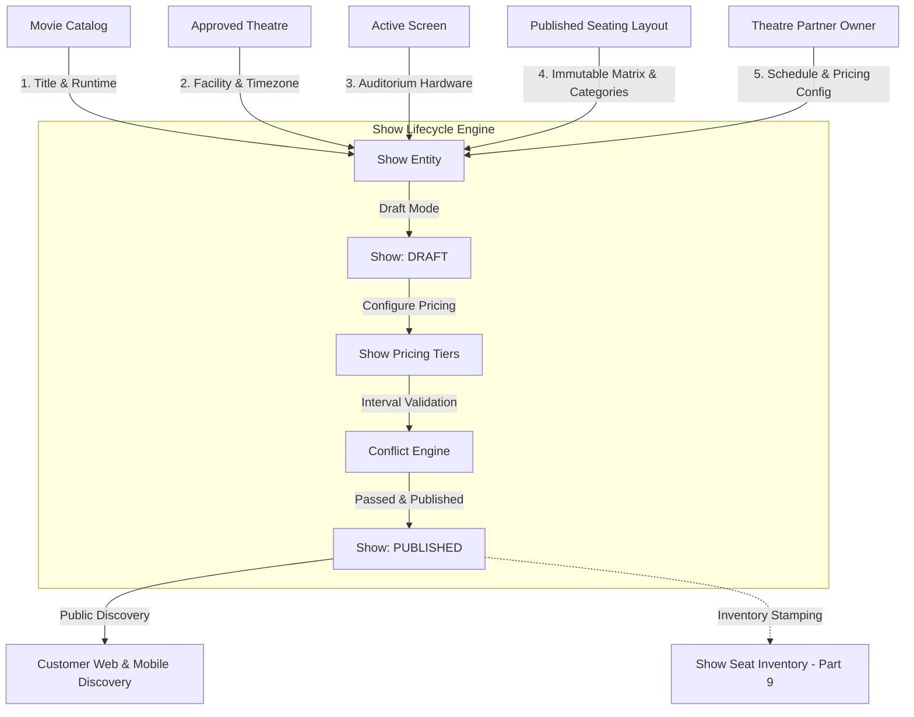

# Show Management & Scheduling Module Overview

## 1. Executive Summary
The **Show Management & Scheduling Module** (Part 8) represents the operational junction of the BookMyShow Clone platform. It dynamically binds five independent architectural domains:
1. **Catalog Domain**: Approved titles, runtimes, formats, and spoken languages from the Movie module.
2. **Facility Domain**: Multi-tenant cinema multiplexes and branches from the Theatre module.
3. **Spatial Domain**: Auditoriums, sound systems, and projection hardware from the Screen module.
4. **Inventory Domain**: Immutable published seating layout versions and category breakdowns from the Seating Layout module.
5. **Commercial Domain**: Show-specific category pricing tiers, convenience fees, and tax calculations.

---

## 2. High-Level Architecture & Domain Relationships

---

## 3. Core Capabilities
- **Strict Tenant Isolation**: All show operations are strictly scoped to the authenticated theatre partner (`partnerId`), guaranteeing zero BOLA/IDOR vulnerabilities across competing cinema chains.
- **Interval Collision Engine**: Mathematical temporal overlap detection enforcing cleaning/turnaround buffers on a per-screen basis.
- **Race Condition Protection**: Distributed screen-level lock coordination (Redis-backed with distributed fallback) + MongoDB ACID transactions to prevent simultaneous double-booking of auditoriums.
- **Immutable Layout Binding**: Shows are bound to specific `layoutVersion` numbers, ensuring future auditorium renovations do not alter historical show inventories.
- **Dynamic Category Pricing**: Show-specific pricing matrix mapped directly to the actual categories present in the auditorium's layout.
- **Comprehensive Public APIs**: High-performance public listing endpoints filtered strictly by `status: PUBLISHED`.

