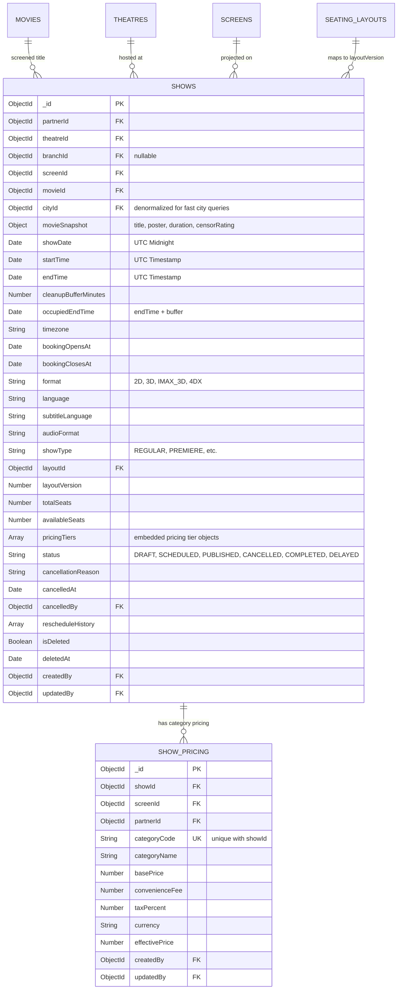

# Show Database Design & Schemas

## 1. Entity-Relationship Model

---

## 2. Collections and Indexes

### 2.1 Collection: `shows`
Primary document store for all scheduled movie events.

| Field | Type | Description |
|---|---|---|
| `_id` | ObjectId | Primary Key |
| `partnerId` | ObjectId | Tenant isolation key (Ref: `theatre_partners`) |
| `theatreId` | ObjectId | Parent Cinema Multiplex (Ref: `theatres`) |
| `screenId` | ObjectId | Auditorium Hall (Ref: `screens`) |
| `movieId` | ObjectId | Screened Film (Ref: `movies`) |
| `cityId` | ObjectId | Denormalized City ID (Ref: `cities`) for zero-join geographic querying |
| `movieSnapshot` | Object | Preserves title, poster, runtime, and censor rating at show creation |
| `showDate` | Date | Calendar date normalized to UTC midnight `00:00:00.000Z` |
| `startTime` | Date | Screening start timestamp in UTC |
| `endTime` | Date | Screening end timestamp in UTC |
| `cleanupBufferMinutes` | Number | Turnaround & maintenance buffer (Default: 20 minutes) |
| `occupiedEndTime` | Date | `endTime + cleanupBufferMinutes` (indexed for overlap detection) |
| `timezone` | String | IANA timezone (e.g., `Asia/Kolkata`) |
| `pricingTiers` | [Object] | Embedded category pricing records |
| `layoutVersion` | Number | Immutable layout version locked to the auditorium |
| `status` | String | Lifecycle state: `DRAFT`, `SCHEDULED`, `PUBLISHED`, `CANCELLED`, `COMPLETED`, `DELAYED` |

#### Compound Indexes
1. `{ screenId: 1, startTime: 1, occupiedEndTime: 1, status: 1 }`
   - Purpose: Real-time interval overlap queries on a screen.
2. `{ cityId: 1, movieId: 1, showDate: 1, status: 1 }`
   - Purpose: Primary public customer discovery index.
3. `{ theatreId: 1, showDate: 1, startTime: 1 }`
   - Purpose: Cinema daily schedule listing.
4. `{ partnerId: 1, showDate: -1 }`
   - Purpose: Theatre partner operational dashboard queries.
5. `{ movieId: 1, status: 1 }`
   - Purpose: Rapid title availability lookup.

---

### 2.2 Collection: `show_pricing`
Dedicated pricing tier records per show and seat category.

#### Compound Unique Constraints
- `{ showId: 1, categoryCode: 1 }` (Unique): Ensures each seat category has exactly one pricing configuration per show.
- `{ partnerId: 1, showId: 1 }`: Fast tenant pricing auditing.

