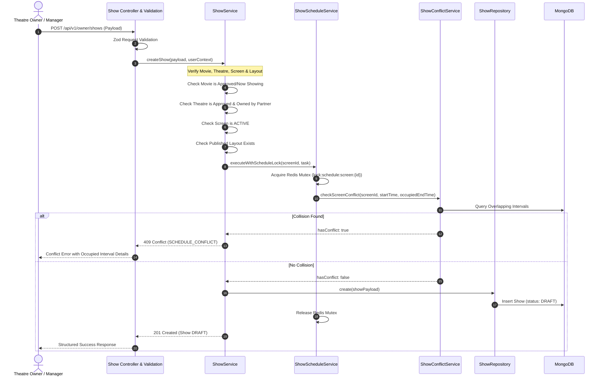

# Show Scheduling & Operational Workflow

## 1. Scheduling Pipeline Sequence

---

## 2. Schedule Validation Rules
1. **Movie Eligibility**: Movie status must be `APPROVED`, `NOW_SHOWING`, or `UPCOMING`. Draft or suspended movies cannot be scheduled.
2. **Facility Integrity**: Screen must belong to the selected theatre. Screen status must be `ACTIVE` (`isActive: true`).
3. **Auditorium Blueprint**: Screen must possess at least one published seating layout.
4. **Calculated Durations**: If `durationMins` is not supplied, it defaults to the movie's catalog runtime. `endTime` is calculated as `startTime + durationMins`.
5. **Turnaround & Buffer**: A turnaround buffer (default 20 minutes) is appended to `endTime` to produce `occupiedEndTime`, representing the full time the auditorium is unavailable.

