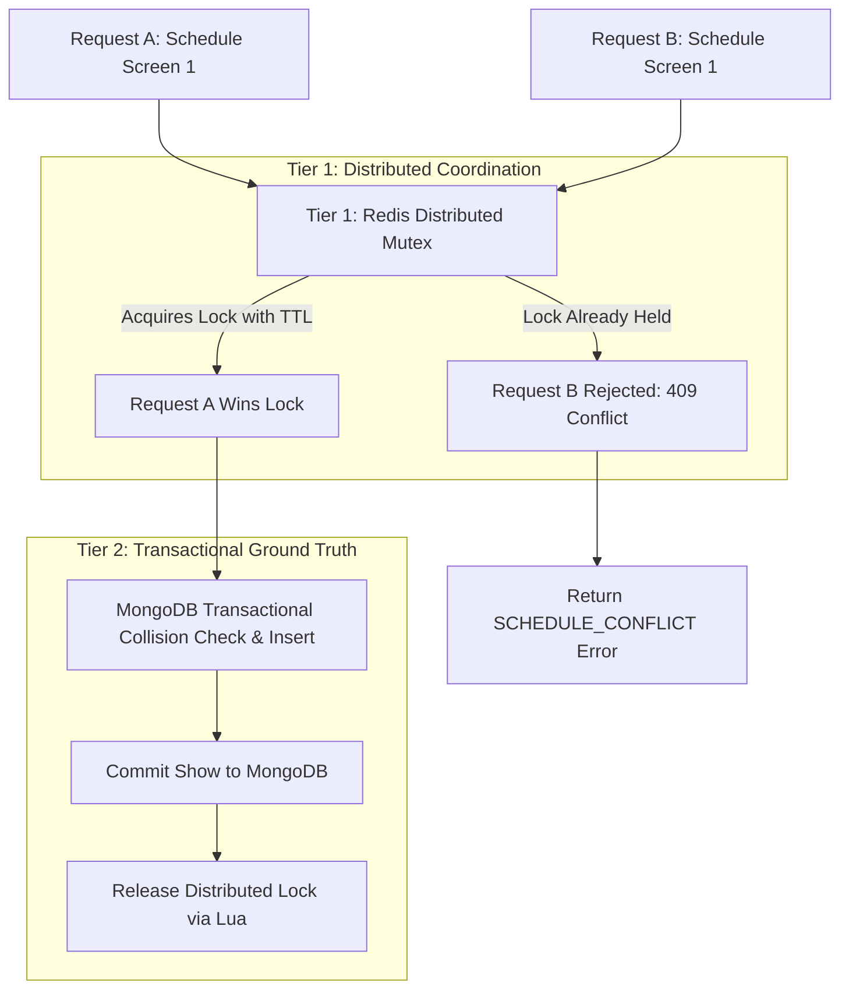

# Concurrency & Race Condition Protection

## 1. The Distributed Double-Booking Race Condition

In high-concurrency enterprise cinema operations, multiple theatre managers or automated distribution schedulers may attempt to schedule shows concurrently.

### The Race Condition Scenario:
1. **12:00:00.000**: Request $A$ attempts to schedule Movie 1 on Screen 1 at 2:00 PM.
2. **12:00:00.002**: Request $B$ attempts to schedule Movie 2 on Screen 1 at 2:30 PM.
3. Both requests query MongoDB for conflicts before either has written its record.
4. Both queries return `hasConflict: false`.
5. Both requests insert their records.
6. **Result**: Corrupted schedule with overlapping shows on Screen 1.

---

## 2. Two-Tier Concurrency Architecture

To eliminate this vulnerability, the system implements a **Two-Tier Distributed Defense**:



---

## 3. Tier 1: Distributed Screen Mutex (Redis)
- **Lock Key**: `lock:schedule:screen:${screenId}`
- **Mutual Exclusion**: `SET key token NX EX 10`
  - Atomic set-if-not-exists (`NX`).
  - Auto-expiring TTL of 10 seconds (`EX 10`) guarantees that server crashes or network partitions cannot permanently lock a screen.
- **Cryptographic Token Verification**: Each lock holder receives a UUID token.
- **Safe Release via Lua**:
  ```lua
  if redis.call("get", KEYS[1]) == ARGV[1] then
    return redis.call("del", KEYS[1])
  else
    return 0
  end
  ```
  Prevents a slow process whose lock expired from deleting a subsequent process's lock.

---

## 4. Tier 2: Durable Database Transaction
- MongoDB remains the authoritative source of truth.
- The collision check and insert are executed within a MongoDB ClientSession (when connected to a replica set).
- Handled via `ShowScheduleService.executeWithScheduleLock(screenId, taskFn)`.

---

## 5. Automated Verification
The concurrency protection is verified via automated integration tests in:
`apps/backend/tests/integration/show-concurrency.test.js`
Where two simultaneous asynchronous scheduling calls (`Promise.all([reqA, reqB])`) are asserted to result in exactly one successful creation and one `409 Conflict` rejection.

