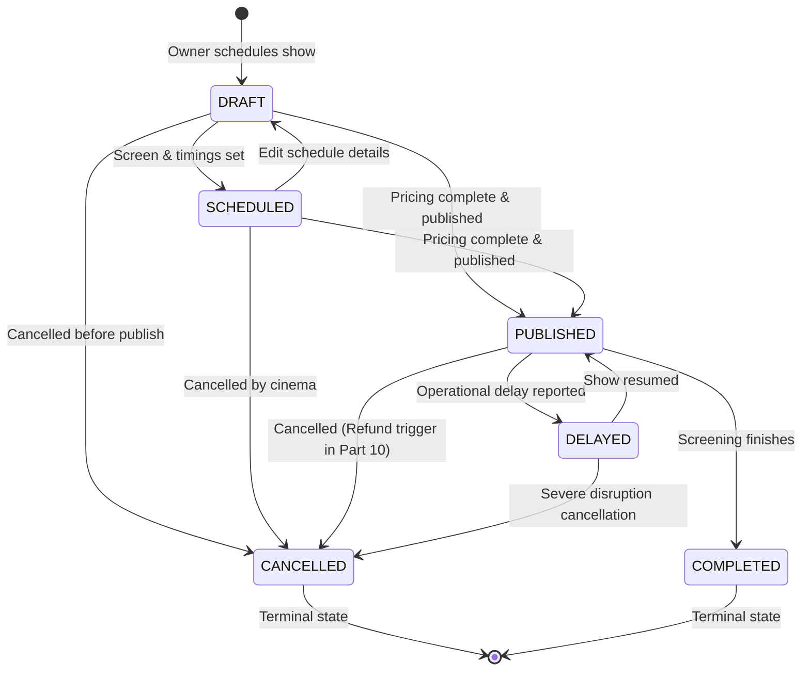

# Show Publishing and Cancellation Workflows

## 1. Show Lifecycle State Machine

---

## 2. Show Publishing Workflow (`POST /owner/shows/:showId/publish`)

Before a show is opened to the public for seat selection and ticket sales, the system validates the **Pre-Publication Checklist**:
1. **Facility Health**: Screen must be in active operational status (`ACTIVE`).
2. **Layout Integrity**: The published seating layout reference and `layoutVersion` must remain intact.
3. **Pricing Completeness**: Every seat category present in the screen layout must have a valid pricing tier assigned. If any category is missing, publication fails with `ErrorCodes.PRICING_INCOMPLETE`.
4. **Collision Double-Check**: Re-verifies that no newly inserted show has created an interval collision.
5. **State Transition**: Transitions status from `DRAFT` or `SCHEDULED` to `PUBLISHED`.

---

## 3. Show Cancellation Workflow (`POST /owner/shows/:showId/cancel`)

When an auditorium faces technical faults (e.g., sound failure, power disruption):
1. **Authorization**: Only authorized theatre owners or assigned managers can cancel shows.
2. **Reason Requirement**: A mandatory `reason` text must be provided (minimum 3 characters).
3. **State Transition**: Sets `status: CANCELLED`, stamps `cancelledAt: Date.now()`, and records `cancelledBy: userId`.
4. **Immediate Booking Termination**: Cancelled shows are immediately excluded from public listings (`GET /shows`) and reject all booking attempts.
5. **Future Refund Integration Point**: Stamped cancellation records serve as the upstream event trigger for the automated refund engine in Part 10.

