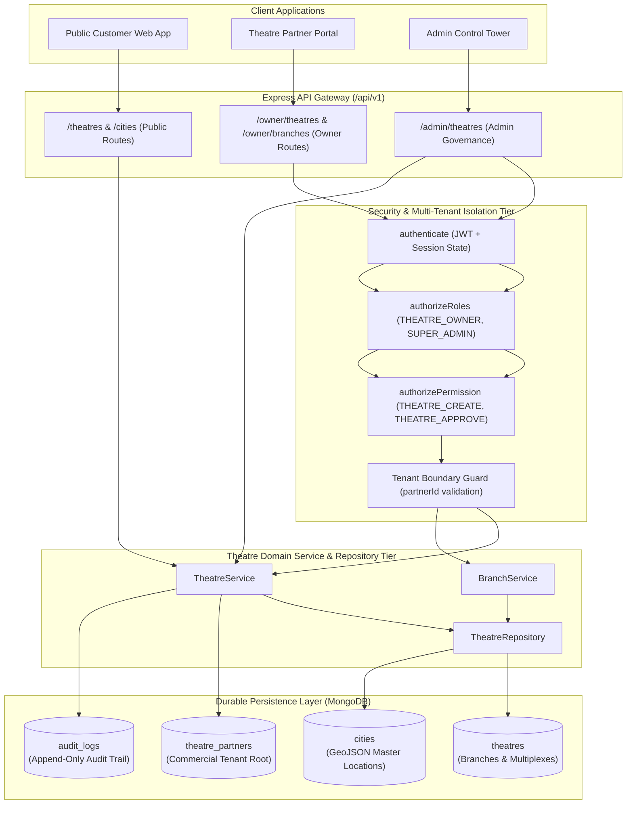

# 01. Theatre & Branch Management Module Overview

This document provides a comprehensive system overview of the **Theatre & Branch Management Module** (Part 6) within the enterprise Movie Ticket Booking Platform (BookMyShow Clone).

---

## 1. Domain Scope & Objectives

The Theatre & Branch Management Module is the core operational bridge between multi-tenant cinema commercial partners and downstream exhibition subsystems (screens, auditoriums, show scheduling, seat layouts, real-time inventory locking, and booking engines).

### 1.1 Core Business Capabilities
1. **Multi-Tenant Partner & Theatre Governance**:
   - Commercial cinema brands (`theatre_partners`) operate multiple physical cinema multiplexes (`theatres`), acting as physical branches distributed across cities.
   - Dynamic theatre onboarding with an 8-state administrative compliance verification state machine (`DRAFT`, `PENDING_APPROVAL`, `UNDER_REVIEW`, `APPROVED`, `REJECTED`, `SUSPENDED`, `INACTIVE`).
2. **Branch Management**:
   - Support for multiple branches/multiplexes per partner tenant.
   - Clean architectural alignment: as established in Part 2, physical cinemas (`theatres`) model branches of the partner entity, avoiding redundant duplicate collections while exposing dedicated branch endpoints.
3. **Geospatial & Location-Based Discovery**:
   - Master city integration (`cities` collection).
   - High-throughput geospatial discovery powered by MongoDB `2dsphere` indexes, enabling distance-bounded searches (`$near` / `$maxDistance`) and municipal filtering.
4. **Multi-Tenant Ownership & BOLA/IDOR Security**:
   - Zero frontend trust: `partnerId` and `ownerId` are derived strictly from cryptographically verified JWT bearer tokens and active session contexts.
   - Reusable tenant isolation guards prevent cross-tenant access to another partner's theatres, branches, screens, or staff.
5. **Staff & Delegation Governance**:
   - In-theatre delegation enabling theatre owners to assign authenticated users as `THEATRE_MANAGER` or `THEATRE_STAFF` to specific properties.
   - Complete audit logging of all assignments, administrative state transitions, and operational updates.

---

## 2. High-Level System Architecture



---

## 3. Layered Architectural Decomposition

The module follows the standardized 7-layer modular monolith architecture established across the platform:

```text
apps/backend/src/modules/theatres/
├── theatre.model.js          # Mongoose schema, compound indexes, 2dsphere, text search
├── theatre.routes.js         # Owner, Admin, and Public Express routers
├── theatre.controller.js     # Thin HTTP controllers with standardized envelopes
├── theatre.service.js        # Business logic, state transitions, tenant checks, audit logs
├── theatre.repository.js     # Data access layer, geospatial queries, soft-deletes
├── theatre.validation.js     # Zod runtime input schemas for all payloads and queries
├── theatre.constants.js      # Statuses, amenities, operating days, transition matrices
├── theatre.utils.js          # Slug generator, coordinate validators, state transitions
├── model/
│   ├── theatre.model.js      # Primary physical cinema complex schema
│   └── city.model.js         # GeoJSON master city catalog schema
└── branch/
    ├── branch.service.js     # Physical branch delegation logic
    ├── branch.controller.js  # Branch HTTP controllers
    └── branch.routes.js       # Branch Express routes (/owner/theatres/:id/branches)
```

---

## 4. Downstream Integration Preparedness

The module establishes the prerequisite data structures for subsequent development phases:
- **Part 7: Screen & Auditorium Management**: Screens will reference `theatreId` and inherit the denormalized `partnerId` for zero-join tenant verification.
- **Part 8: Seating Layout Visualizer**: Visual seating grids will map physical rows and categories directly to auditoriums within approved theatres.
- **Part 9: Show Scheduling Engine**: Showtimes will require active, approved theatres (`status: 'APPROVED'`, `isActive: true`, `isDeleted: false`) before auditorium screen allocation is permitted.

