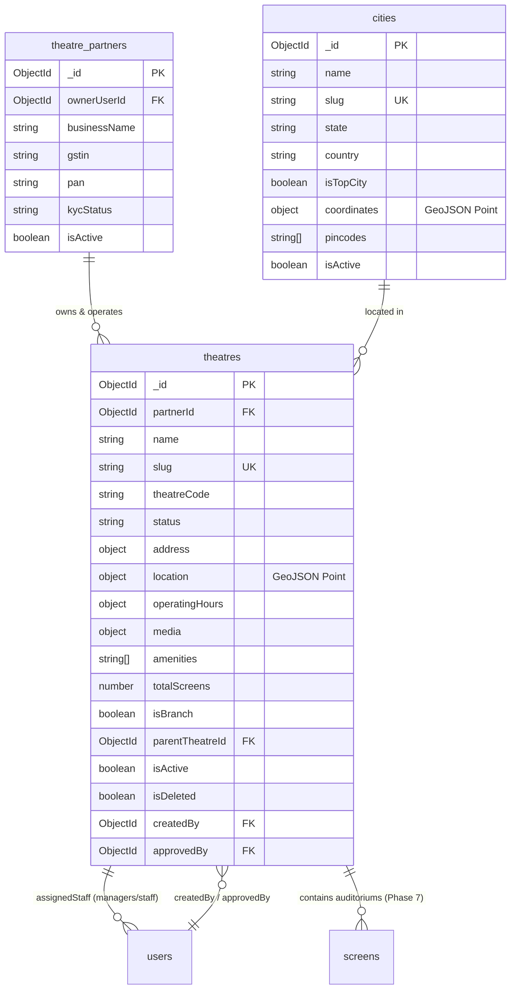

# 02. Theatre Database Design & Schema Specifications

This document defines the schema architecture, field specifications, data relationships, indexing strategies, and geospatial structures governing the **Theatre & Branch Management Module**.

---

## 1. Entity-Relationship Overview



---

## 2. Collection Specifications

### 2.1 Collection: `theatres`

Physical cinema properties and multiplex branches operating under a commercial partner tenant.

| Field Name | Type | Required | Default | Description & Invariants |
| :--- | :--- | :---: | :---: | :--- |
| `_id` | `ObjectId` | Yes | Auto | Primary Key |
| `partnerId` | `ObjectId` | Yes | — | Ref: `theatre_partners`. Primary tenant boundary. |
| `name` | `String` | Yes | — | Cinema name (e.g., "PVR ICON: Phoenix Palladium"). Max 200 chars. |
| `slug` | `String` | Yes | — | Lowercase, hyphenated URL slug. Unique system-wide. |
| `theatreCode` | `String` | No | `""` | Partner-scoped internal code (e.g., "PVR-MUM-01"). Unique per partner. |
| `description` | `String` | No | `""` | Description of cinema complex. Max 2000 chars. |
| `status` | `String` | Yes | `PENDING_APPROVAL` | Enum: `DRAFT`, `PENDING_APPROVAL`, `UNDER_REVIEW`, `APPROVED`, `REJECTED`, `SUSPENDED`, `INACTIVE`. |
| `rejectionReason` | `String` | No | `""` | Administrative notes if compliance check fails. |
| `contactEmail` | `String` | Yes | — | Valid contact email for box office operations. |
| `contactPhone` | `String` | Yes | — | E.164 phone string for cinema inquiries. |
| `websiteUrl` | `String` | No | `""` | External website URL. |
| `address` | `SubDoc` | Yes | — | Physical street address, area, city reference, state, pincode. |
| `location` | `SubDoc` | Yes | — | GeoJSON `{ type: "Point", coordinates: [lng, lat] }`. |
| `businessDetails` | `SubDoc` | No | `{}` | Legal trade name, GSTIN, municipal license reference. |
| `media` | `SubDoc` | No | `{}` | Logo, poster, exterior and interior Cloudinary photo URLs. |
| `operatingHours` | `SubDoc` | No | `{}` | Daily opening time (HH:MM), closing time (HH:MM), operating days. |
| `amenities` | `[String]` | No | `[]` | Enum array (`PARKING`, `FOOD_BEVERAGES`, `DOLBY_ATMOS`, `IMAX`, `4DX`, etc.). |
| `totalScreens` | `Number` | Yes | `0` | Count of registered auditoriums (incremented in Part 7). |
| `isBranch` | `Boolean` | Yes | `true` | Indicates branch status under parent commercial tenant. |
| `parentTheatreId` | `ObjectId` | No | `null` | Ref: `theatres`. Parent flagship reference if nested branch. |
| `isActive` | `Boolean` | Yes | `true` | Operational status toggle. |
| `isSuspended` | `Boolean` | Yes | `false` | Compliance suspension flag. |
| `isDeleted` | `Boolean` | Yes | `false` | Soft-deletion flag. |
| `deletedAt` | `Date` | No | `null` | Timestamp when soft-deleted. |
| `createdBy` | `ObjectId` | Yes | — | Ref: `users`. User ID of the creator. |
| `approvedBy` | `ObjectId` | No | `null` | Ref: `users`. Super Admin who approved the theatre. |
| `approvedAt` | `Date` | No | `null` | Timestamp of administrative approval. |

---

### 2.2 Sub-Document Definitions

#### A. Address Sub-Document (`address`)
```javascript
{
  street: { type: String, required: true },
  landmark: { type: String, default: '' },
  area: { type: String, required: true },
  cityId: { type: mongoose.Schema.Types.ObjectId, ref: 'cities', required: true },
  cityName: { type: String, default: '' }, // Denormalized for zero-join queries
  state: { type: String, required: true },
  country: { type: String, default: 'India' },
  pincode: { type: String, required: true, match: /^\d{6}$/ }
}
```

#### B. Location Sub-Document (`location`)
```javascript
{
  type: { type: String, enum: ['Point'], default: 'Point' },
  coordinates: { type: [Number], required: true } // [longitude, latitude]
}
```

#### C. Operating Hours Sub-Document (`operatingHours`)
```javascript
{
  openingTime: { type: String, default: '09:00', match: /^([01]\d|2[0-3]):[0-5]\d$/ },
  closingTime: { type: String, default: '23:59', match: /^([01]\d|2[0-3]):[0-5]\d$/ },
  operatingDays: { 
    type: [String], 
    enum: ['MON', 'TUE', 'WED', 'THU', 'FRI', 'SAT', 'SUN'],
    default: ['MON', 'TUE', 'WED', 'THU', 'FRI', 'SAT', 'SUN']
  }
}
```

---

### 2.3 Collection: `cities`

Master geographic repository for municipal operational zones.

| Field Name | Type | Required | Default | Description |
| :--- | :--- | :---: | :---: | :--- |
| `_id` | `ObjectId` | Yes | Auto | Primary Key |
| `name` | `String` | Yes | — | Municipal city name (e.g., "Mumbai", "Bengaluru"). |
| `slug` | `String` | Yes | — | Unique URL slug (e.g., "mumbai"). |
| `state` | `String` | Yes | — | State or province (e.g., "Maharashtra"). |
| `country` | `String` | Yes | `India` | Country. |
| `isTopCity` | `Boolean` | Yes | `false` | Featured on the consumer city selection modal. |
| `coordinates` | `SubDoc` | Yes | — | GeoJSON Point representing the municipal geographic center. |
| `pincodes` | `[String]` | No | `[]` | Array of postal PIN codes covered by the city. |
| `isActive` | `Boolean` | Yes | `true` | Operational booking toggle. |
| `deletedAt` | `Date` | No | `null` | Soft deletion marker. |

---

## 3. Database Indexing Strategy

To guarantee sub-50ms query execution across millions of customer requests and thousands of cinema branches:

| Index Name | Collection | Key Pattern | Type | Justification |
| :--- | :--- | :--- | :---: | :--- |
| `idx_theatre_unique_slug` | `theatres` | `{ slug: 1 }` | Unique | Fast deep-link lookup by URL slug. |
| `idx_theatre_partner_isolation` | `theatres` | `{ partnerId: 1, isDeleted: 1 }` | Compound | High-frequency partner portal queries with zero cross-tenant leakage. |
| `idx_theatre_public_discovery` | `theatres` | `{ status: 1, isActive: 1, isDeleted: 1 }` | Compound | Fast public listing filtering only approved, active titles. |
| `idx_theatre_city_search` | `theatres` | `{ 'address.cityId': 1, status: 1, isDeleted: 1 }` | Compound | City-scoped cinema discovery index. |
| `idx_theatre_geospatial` | `theatres` | `{ location: '2dsphere' }` | Geospatial | Spherical distance calculations (`$near`, `$geoWithin`) for nearby searches. |
| `idx_theatre_text_search` | `theatres` | `{ name: 'text', 'address.area': 'text', 'address.street': 'text' }` | Full-Text | Multi-field weighted text matching. |
| `idx_city_unique_slug` | `cities` | `{ slug: 1 }` | Unique | Fast city lookup by URL slug. |
| `idx_city_coordinates` | `cities` | `{ coordinates: '2dsphere' }` | Geospatial | Nearest city detection. |
| `idx_city_picker_modal` | `cities` | `{ isActive: 1, isTopCity: -1, name: 1 }` | Compound | Instant retrieval of top featured cities on frontend load. |

