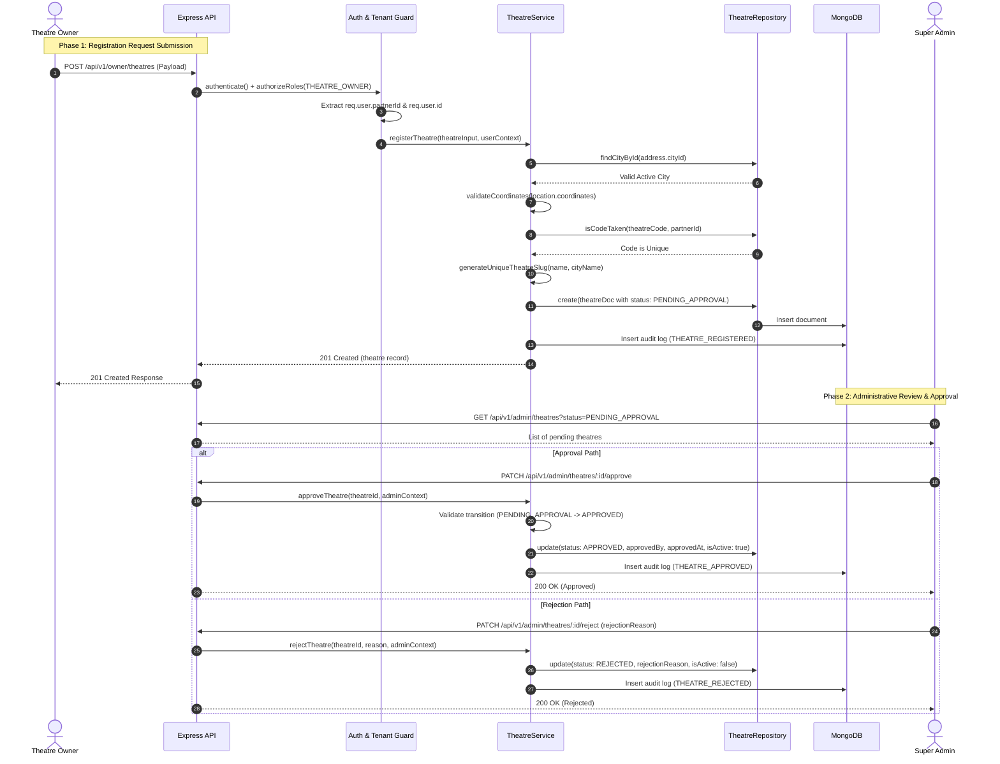

# 03. Theatre Registration & Compliance Lifecycle

This document specifies the end-to-end lifecycle for cinema multiplex onboarding, validation protocols, administrative compliance verification, and status transitions in the **Theatre & Branch Management Module**.

---

## 1. End-to-End Registration Workflow



---

## 2. Invariant Enforcement on Registration

When `POST /api/v1/owner/theatres` is invoked, the service enforces the following strict invariants:

1. **Authenticated Context Derivation**:
   - `partnerId` is derived exclusively from `req.user.partnerId`. If a client supplies `partnerId`, `ownerId`, or `tenantId` in the request body, it is discarded during Zod schema parsing.
   - If the authenticated user is not associated with an approved partner (`user.partnerId === null`), the request is rejected with `403 Forbidden` (`TENANT_ACCESS_DENIED`).
2. **City & Locality Referential Verification**:
   - `address.cityId` must reference an active, non-deleted record in `cities`.
   - The municipal city name is denormalized directly into `address.cityName` to accelerate discovery without pipeline joins.
3. **Geospatial Coordinate Validation**:
   - Coordinates must follow GeoJSON `[longitude, latitude]` format.
   - Longitude must strictly reside in $[-180, 180]$; Latitude in $[-90, 90]$.
4. **Partner-Scoped Code Uniqueness**:
   - An internal identifier (e.g. `theatreCode: "PVR-MUM-01"`) must be unique across all active theatres owned by that specific partner.
5. **Deterministic URL Slug Generation**:
   - Slug is created by combining `{name}-{cityName}`.
   - In case of duplicate names within the same city, sequential numerical suffixes (`-2`, `-3`) are appended automatically.
6. **Immutable Administrative Defaults**:
   - Newly registered theatres are always assigned `status = 'PENDING_APPROVAL'`.
   - Attributes `approvedBy`, `approvedAt`, `isSuspended`, and `isDeleted` are initialized to `null` or `false`.
   - The creator's user account ID is stamped permanently into `createdBy`.

---

## 3. Allowed Status State Machine

The status transitions follow strict governance rules:

| Initial Status | Target Status | Permitted Actor | Purpose |
| :--- | :--- | :--- | :--- |
| `DRAFT` | `PENDING_APPROVAL` | Theatre Owner | Submits drafted theatre for administrative review. |
| `PENDING_APPROVAL` | `UNDER_REVIEW` | Super Admin | Compliance team begins verifying municipal documents. |
| `PENDING_APPROVAL` | `APPROVED` | Super Admin | Theatre verified; made discoverable and eligible for screens. |
| `PENDING_APPROVAL` | `REJECTED` | Super Admin | Rejected with explanatory `rejectionReason`. |
| `REJECTED` | `DRAFT` / `PENDING_APPROVAL` | Theatre Owner | Partner rectifies deficiency and resubmits. |
| `APPROVED` | `SUSPENDED` | Super Admin | Suspended due to licensing lapse or commercial dispute. |
| `SUSPENDED` | `APPROVED` | Super Admin | Reactivated upon dispute resolution. |
| `APPROVED` | `INACTIVE` | Theatre Owner / Admin | Voluntary temporary closure for renovation. |

---

## 4. Audit Logging Protocol

Every lifecycle transition emits an immutable, structured audit entry into `audit_logs`:

```json
{
  "_id": { "$oid": "67220b3f81e7d23a104f9810" },
  "action": "THEATRE_APPROVED",
  "userId": { "$oid": "67220b3f81e7d23a104f9101" },
  "details": {
    "theatreId": "67220b3f81e7d23a104f9911",
    "theatreName": "PVR ICON: Phoenix Palladium",
    "previousStatus": "PENDING_APPROVAL",
    "partnerId": "67220b3f81e7d23a104f9901"
  },
  "ipAddress": "192.168.1.10",
  "userAgent": "Mozilla/5.0 ...",
  "createdAt": { "$date": "2026-10-30T10:15:00.000Z" }
}
```

