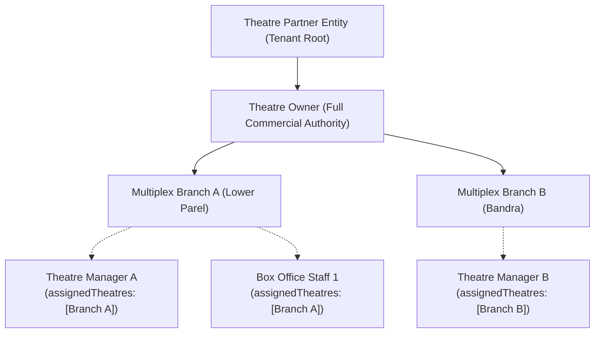

# 04. Theatre Owner Permissions & Delegation Architecture

This document outlines the role-based access control, operational boundaries, permitted actions, and delegation mechanisms governing **Theatre Owners** in the platform.

---

## 1. Role Definition & Permissions Mapping

A **Theatre Owner** (`Roles.THEATRE_OWNER`) represents the legal signatory or appointed corporate executive of a cinema partner tenant (`theatre_partners`).

### 1.1 Granted Permissions

From `apps/backend/src/modules/auth/auth.constants.js`:

```javascript
[Roles.THEATRE_OWNER]: [
  Permissions.USER_READ,
  Permissions.USER_UPDATE,
  Permissions.MOVIE_READ,
  Permissions.THEATRE_READ,
  Permissions.THEATRE_CREATE,
  Permissions.THEATRE_UPDATE,
  Permissions.THEATRE_DELETE,
  Permissions.SCREEN_MANAGE,
  Permissions.SHOW_READ,
  Permissions.SHOW_CREATE,
  Permissions.SHOW_UPDATE,
  Permissions.SHOW_DELETE,
  Permissions.BOOKING_READ,
  Permissions.BOOKING_MANAGE,
  Permissions.PAYMENT_READ,
  Permissions.REPORT_READ,
  Permissions.STAFF_MANAGE
]
```

---

## 2. Permitted vs. Prohibited Operations

| Operational Domain | Permitted Actions (✅) | Strictly Prohibited Actions (❌) | Enforcement Mechanism |
| :--- | :--- | :--- | :--- |
| **Theatre Creation** | Register new cinema complex in any active city. | Supply custom `partnerId`, `status: APPROVED`, or `approvedBy`. | Server derives `partnerId`; status forced to `PENDING_APPROVAL`. |
| **Catalog Listing** | List all theatres belonging to own partner tenant. | Query or browse theatres belonging to other cinema brands. | Repository queries filter `{ partnerId: req.user.partnerId }`. |
| **Theatre Updating** | Update contact numbers, street address, operating hours, amenities, and photos. | Mutate `partnerId`, `theatreCode` (if collision), `status`, `approvedBy`, or `isSuspended`. | Controller whitelist and service delete-guards strip protected keys. |
| **Theatre Deletion** | Soft-delete a theatre that has zero auditoriums (`totalScreens === 0`). | Destroy historical booking records or delete theatres with active screens. | Service raises `409 Conflict` (`RESOURCE_IN_USE`) if screens are configured. |
| **Staff Delegation** | Assign existing registered users as `THEATRE_MANAGER` or `THEATRE_STAFF` to own cinemas. | Assign `SUPER_ADMIN` role, or assign staff to another partner's cinemas. | Role checks reject privilege escalation attempts with `403 Forbidden`. |
| **Compliance Approvals** | View compliance feedback and rejection notes. | Approve own theatres, lift suspensions, or alter commission rates. | `THEATRE_APPROVE` permission is reserved strictly for `SUPER_ADMIN`. |

---

## 3. Theatre Staff & Manager Assignment

Cinema multiplex chains require multi-tiered on-ground delegation without granting full administrative ownership to shift workers or box-office cashiers.



### 3.1 Delegation Rules & Invariants
1. **Target User Validation**: The user being assigned must exist and have an active user account.
2. **Ecosystem Non-Interference**: If the user already belongs to another cinema chain (`user.partnerId !== currentPartnerId`), assignment is blocked (`409 Conflict`) to prevent corporate espionage or split credential contexts.
3. **Privilege Boundary**:
   - `THEATRE_MANAGER`: Can configure auditoriums, schedule shows, and view box-office reports for assigned theatres.
   - `THEATRE_STAFF`: Can scan gate QR tickets and validate admissions at auditorium doors.
4. **Immediate Revocation**:
   - When an owner removes a user from a theatre (`DELETE /api/v1/owner/theatres/:id/staff/:userId`), the cinema reference is removed from `assignedTheatres`.
   - If the user has zero remaining assigned cinemas, their role is cleanly downgraded to `CUSTOMER` and `partnerId` is detached.

